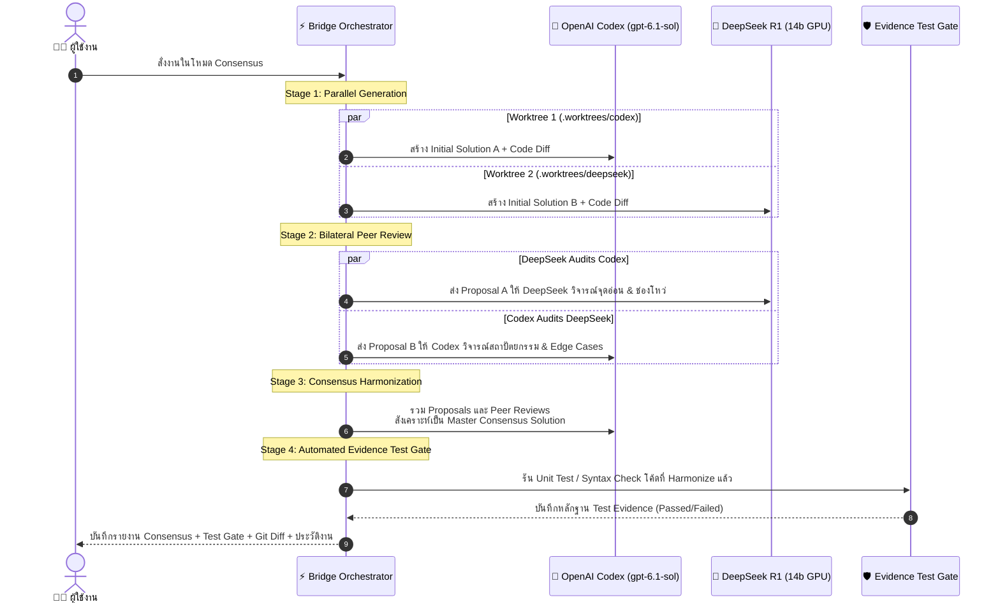

# 🌉 Proxmox Codex Bridge & Multi-Agent Platform

ระบบเชื่อมต่อและบริดจ์คำสั่งอัจฉริยะ (Multi-Agent Bridge) ที่ผสานพลังของ **Google Antigravity**, **OpenAI Codex (gpt-6.1-sol)** บน Proxmox LXC Container และ **DeepSeek R1 (14b GPU)** บน CS KMITL GPU Cluster ควบคุมการทำงานด้วย **PM2 Process Manager**, **Redis 7 Job Queue & Worker**, ระบบสตรีมมิ่งสด **Server-Sent Events (SSE)**, **Automated Evidence Test Gate**, และ Web Dashboard แบบ Real-time บน Svelte 5

🌐 **Web Dashboard:** [http://192.168.5.159:3000](http://192.168.5.159:3000) (เข้าถึงผ่านเครือข่ายภายใน)

---

## 📑 สารบัญ (Table of Contents)
- [🏗️ สถาปัตยกรรมระบบ (System Architecture)](#️-สถาปัตยกรรมระบบ-system-architecture)
- [🚀 ฟีเจอร์หลัก (Core Features)](#-ฟีเจอร์หลัก-core-features)
- [🛡️ สถาปัตยกรรมความปลอดภัย (Security Architecture & Best Practices)](#️-สถาปัตยกรรมความปลอดภัย-security-architecture--best-practices)
- [⚙️ คู่มือการจัดการระบบด้วย PM2 (PM2 Process Management)](#️-คู่มือการจัดการระบบด้วย-pm2-pm2-process-management)
- [⚡ การทำงานของ Redis 7 Job Queue & Worker](#-การทำงานของ-redis-7-job-queue--worker)
- [🛡️ Automated Evidence Test Gate (Evidence-Based Testing)](#️-automated-evidence-test-gate-evidence-based-testing)
- [📡 Real-time SSE Streaming & Report Export](#-real-time-sse-streaming--report-export)
- [1. 🧩 โครงสร้าง 11 Modular Components (Svelte 5 Runes)](#1--โครงสร้าง-11-modular-components-svelte-5-runes)
- [2. 🗂️ ระบบ Auto Temp Workspace และ Safe Lease Guard](#2-️-ระบบ-auto-temp-workspace-และ-safe-lease-guard)
- [3. 🎯 Task Intent Detection (Code vs General / Planning)](#3--task-intent-detection--code-vs--general--planning)
- [4. 🛡️ กฎเหล็ก Anti-Hallucination & Multi-Agent Strict Policy](#4-️-กฎเหล็ก-anti-hallucination--multi-agent-strict-policy)
- [5. 🌲 Dual Compare View & Git Worktree Isolation](#5--dual-compare-view--git-worktree-isolation)
- [6. 🤝 Multi-Agent Consensus Loop (Bilateral Peer Review)](#6--multi-agent-consensus-loop-bilateral-peer-review)
- [🛠️ คู่มือการติดตั้งตั้งแต่ศูนย์ (Step-by-Step Installation)](#️-คู่มือการติดตั้งตั้งแต่ศูนย์-step-by-step-installation)
- [⚡ การใช้งาน Permanent CLI Runner (scripts/ask_models.py)](#-การใช้งาน-permanent-cli-runner-scriptsask_modelspy)
- [❓ คำถามที่พบบ่อย (FAQ)](#-คำถามที่พบบ่อย-faq)
- [📝 บันทึกประวัติการพัฒนา (Changelog)](#-บันทึกประวัติการพัฒนา-changelog)

---

## 🏗️ สถาปัตยกรรมระบบ (System Architecture)

```mermaid
flowchart TD
    User["👨‍💻 ผู้ใช้งาน / นักพัฒนา"] -->|CLI / Prompt| Antigravity["🛸 Antigravity (Coding Agent)"]
    User -->|Direct Web UI| Dashboard["🌐 Web Dashboard (Port 3000)\nSvelte 5 + SvelteKit + Tailwind v4"]
    
    subgraph Antigravity_Config["Local Agent Customizations"]
        GlobalRules["📜 Global Rules (~/.gemini/config/rules/)\n- Strict Anti-Hallucination\n- Auto Tool Routing"]
        CLIHelper["⚡ Permanent CLI Runner\n(ask_models.py with SSE & Queue)"]
    end
    Antigravity --- Antigravity_Config
    
    Dashboard -->|POST /api/task (202 Accepted)| Backend["⚡ SvelteKit Backend Server"]
    CLIHelper -->|POST /api/task (202 Accepted)| Backend
    
    subgraph Proxmox_CT["Proxmox LXC Container (192.168.5.159)"]
        subgraph PM2_Daemon["PM2 Process Manager"]
            Backend
            Worker["⚙️ Background Task Worker Loop"]
        end

        subgraph Security_Shield["🛡️ Security & Isolation Shield"]
            EnvSecrets[("🔒 .env File (chmod 600)\n(No Tokens in Git)")]
            PathShield["🚫 Path Traversal Shield\n(Strict path.resolve)"]
            AuthGuard["🔑 Optional Bearer Token Auth\n(BRIDGE_API_KEY)"]
        end
        
        subgraph Redis_Layer["Redis 7 Infrastructure"]
            RedisQueue[("📥 tasks:queue\n(FIFO Task Queue)")]
            RedisPubSub[("📡 task:events:id\n(PubSub Real-time SSE)")]
            RedisLease[("🔒 workspace:lease\n(Concurrency Guard)")]
        end
        
        TestGate["🛡️ Automated Evidence Test Gate\n(npm test / pytest / syntax check)"]
        Workspaces["📁 Workspaces & Auto-Temp (/opt/agent-bridge/workspaces/)"]
        History["📜 tasks_history.json"]
        
        CodexEngine["🤖 Engine 1: OpenAI Codex CLI\n(gpt-6.1-sol, Dangerously Bypass Sandbox)"]
    end

    subgraph GPU_Cluster["CS KMITL AI GPU Cluster"]
        DeepSeekEngine["🧠 Engine 2: DeepSeek R1 14b\n(aipass.cskmitl.com NDJSON Stream)"]
    end

    Backend -->|Enqueue Job| RedisQueue
    Worker -->|BRPOP Job| RedisQueue
    Worker -->|Acquire Lock| RedisLease
    Worker -->|Publish Status/Logs| RedisPubSub
    Worker -->|Execute| CodexEngine
    Worker -->|Execute (Bearer from .env)| DeepSeekEngine
    Worker -->|Run Verification| TestGate
    Worker -->|Record| History
    RedisPubSub -->|SSE Stream /api/task/id/events| Dashboard
    RedisPubSub -->|SSE Stream /api/task/id/events| CLIHelper
```

---

## 🚀 ฟีเจอร์หลัก (Core Features)

| ฟีเจอร์ | รายละเอียด | สถานะ |
| :--- | :--- | :---: |
| **PM2 Process Manager** | ควบคุม Process ด้วย PM2 (`ecosystem.config.cjs`) มี Auto-restart, Memory Cap 600M, และ Structured Logs | ✅ ใช้งานจริง |
| **Zero-Token Git Security** | ย้าย API Secrets ทั้งหมดไปที่ `.env` (chmod 600) ไม่ให้มี Token หลุดเข้า GitHub 100% | ✅ ใช้งานจริง |
| **Path Traversal Protection** | ตรวจสอบเส้นทางโฟลเดอร์ด้วย `path.resolve` ห้ามเข้าถึงไฟล์ระบบนอก `workspaces/` | ✅ ใช้งานจริง |
| **Redis 7 Job Queue & Worker** | จัดคิวงานแบบ Asynchronous (HTTP 202 + `taskId`) ควบคุมผ่าน Background Worker แยกจาก API Server | ✅ ใช้งานจริง |
| **Server-Sent Events (SSE)** | สตรีมผลลัพธ์ สถานะคิว และขั้นตอนการทำงานแบบเรียลไทม์ผ่าน Redis PubSub | ✅ ใช้งานจริง |
| **Automated Evidence Test Gate** | ตรวจสอบโค้ดอัตโนมัติด้วย Unit Test (`npm test`, `pytest`) หรือ Syntax Check ก่อนรับงาน | ✅ ใช้งานจริง |
| **Safe Workspace Lease Check** | ล็อค Workspace ด้วย Redis Lease ป้องกันการลบ Temp Workspace ระหว่างมีงานรันอยู่ (409 Conflict) | ✅ ใช้งานจริง |
| **Export Report System** | ดาวน์โหลดรายงานผลงานเป็น Markdown (.md), Git Patch (.patch) หรือ Audit JSON (.json) | ✅ ใช้งานจริง |
| **11 Modular Components** | แยกโค้ดหน้าเว็บเป็น 11 คอมโพเนนต์อิสระบน Svelte 5 ด้วย Runes | ✅ ใช้งานจริง |
| **Auto Temp Workspace** | สร้าง Workspace อัตโนมัติตามชื่อคำถาม (Slugify ภาษาไทย/อังกฤษ) | ✅ ใช้งานจริง |
| **Safe Trash & Clean** | ปุ่มลบ Workspace รายตัว และปุ่มล้างโฟลเดอร์ Temp ทั้งหมด (พร้อมการตรวจจับ Active Locks) | ✅ ใช้งานจริง |
| **Task Intent Detection** | จำแนก `💻 Code Task` vs `💡 General / Planning` อัตโนมัติ ป้องกัน Timeout | ✅ ใช้งานจริง |
| **Anti-Hallucination Policy** | กฎเหล็กระดับระบบ ห้ามจำลองคำตอบ ต้องรันโมเดลจริงบนเซิร์ฟเวอร์เสมอ | ✅ ใช้งานจริง |
| **Dual Compare View** | รัน 2 โมเดลพร้อมกัน เปรียบเทียบผลลัพธ์แบบ Side-by-Side | ✅ ใช้งานจริง |
| **Git Worktree Isolation** | แยกพื้นที่ไฟล์ใน `.worktrees/` ขจัดปัญหา Race condition และ Branch collision 100% | ✅ ใช้งานจริง |
| **Multi-Agent Consensus Loop** | ระบบทำงานร่วมกัน 3 ขั้นตอน: Proposals -> Cross Peer Review -> Master Harmonization | ✅ ใช้งานจริง |

---

## 🛡️ สถาปัตยกรรมความปลอดภัย (Security Architecture & Best Practices)

เนื่องจากระบบเชื่อมต่อกับโมเดลภายนอกและสั่งรันคำสั่ง Shell อัตโนมัติ ความปลอดภัยจึงเป็นเรื่องสำคัญที่สุด ระบบจึงได้วางมาตรฐานความปลอดภัย 5 ชั้น ดังนี้:

### 1. การจัดการ Secrets & API Tokens (Zero-Token in Git)
* **ปัญหาเดิม:** การ Hardcode API Key หรือ Token ไว้ในซอร์สโค้ด เสี่ยงต่อการรั่วไหลเมื่อ Push ขึ้น Public GitHub Repository
* **แนวทางแก้ไข:**
  1. ไฟล์โค้ดทั้งหมดจะอ่านผ่าน `process.env.KMITL_TOKEN` หรือ `process.env.OPENAI_API_KEY`
  2. ไฟล์ `.gitignore` บังคับห้ามติดตาม `.env` และ `.env.*` ทุกชนิด (ยกเว้น `.env.example`)
  3. บนเซิร์ฟเวอร์ Proxmox จะสร้างไฟล์ `/opt/agent-bridge/.env` เก็บข้อมูลลับเฉพาะ โดยกำหนดสิทธิ์ไฟล์เข้มงวด:
     ```bash
     chmod 600 /opt/agent-bridge/.env
     ```
  4. ไฟล์ `ecosystem.config.cjs` ของ PM2 จะอ่าน `.env` เข้าหน่วยความจำตอนเริ่มต้น Service โดยตรง

### 2. การป้องกัน Path Traversal (`../../`)
* **ปัญหาเดิม:** หากผู้ใช้หรือโมเดลระบุชื่อ Workspace เป็น `../../etc/` คำสั่งอาจหลุดออกไปอ่านหรือลบไฟล์ของระบบปฏิบัติการ
* **แนวทางแก้ไข:**
  ใน `taskRunner.ts` และ API Routes ทุกตัว จะมีการตรวจสอบอย่างเข้มงวดด้วย `path.resolve`:
  ```typescript
  const target = path.resolve(WORKSPACES_DIR, activeWorkspace);
  if (!target.startsWith(path.resolve(WORKSPACES_DIR))) {
      throw new Error('Security Error: Path traversal attempt detected');
  }
  ```
  หากพบการพยายามเข้าถึงนอกโฟลเดอร์ `/opt/agent-bridge/workspaces/` ระบบจะตัดการทำงานและส่งรหัส **HTTP 403 Forbidden** ทันที

### 3. การป้องกัน API ด้วย Bearer Token (`BRIDGE_API_KEY`)
* ใน `hooks.server.ts` ระบบรองรับตัวเลือกเสริมในการล็อค API:
  * หากกำหนด `BRIDGE_API_KEY=your_secret_token` ในไฟล์ `.env`
  * ทุกคำขอที่เรียกเข้ามายัง `/api/task` หรือ `/api/workspaces` จะต้องส่ง Header:
    ```http
    Authorization: Bearer your_secret_token
    ```
  * หากไม่ส่งหรือส่งผิด จะถูกปฏิเสธด้วยรหัส **HTTP 401 Unauthorized**

### 4. การรันคำสั่งแบบ Stdin Pipe ป้องกัน Command Injection
* คำสั่งของ Codex จะไม่นำ Prompt มาต่อ String ใน Shell ตรงๆ (เช่น `codex exec "$prompt"`) ซึ่งอาจเปิดช่องให้เกิด Shell Injection
* ระบบใช้วิธี **เขียน Prompt ลงไฟล์ชั่วคราวแล้ว Pipe ผ่าน Stdin**:
  ```bash
  cat /tmp/codex_prompt.txt | codex exec --dangerously-bypass-approvals-and-sandbox -C "$target" -
  ```
  ทำให้ตัวอักษรพิเศษ เช่น `;`, `&&`, `|`, `` ` `` ไม่ถูก Shell ตีความเป็นคำสั่งระบบ

### 5. คำแนะนำด้าน Sandbox & Proxmox VE
* **Unprivileged Container:** แนะนำให้สร้าง Proxmox LXC Container ในโหมด **Unprivileged Container (`unprivileged: 1`)** เสมอ เพื่อให้สิทธิ์ `root` ใน Container เทียบเท่ากับ Non-root user บน Proxmox Host ขจัดความเสี่ยงต่อการหลุดออกจาก Container (Container Breakout)
* **Resource Caps:** PM2 ตั้งค่า `max_memory_restart: '600M'` หาก Node.js ใช้หน่วยความจำเกินจะถูกรีสตาร์ทอัตโนมัติ ไม่ทำให้ Container ค้าง

---

## ⚙️ คู่มือการจัดการระบบด้วย PM2 (PM2 Process Management)

ระบบได้รับการตั้งค่าให้รันผ่าน **PM2** เพื่อความเสถียรระดับ Production (Auto-restart on crash, Logging, Memory Monitoring, Zero-downtime reload)

### 1. โครงสร้างการตั้งค่า (`ecosystem.config.cjs`):
```javascript
module.exports = {
  apps: [
    {
      name: 'proxmox-codex-bridge',
      cwd: '/opt/agent-bridge/dashboard',
      script: 'build/index.js',
      instances: 1,
      exec_mode: 'fork',
      autorestart: true,
      watch: false,
      max_memory_restart: '600M',
      env: {
        NODE_ENV: 'production',
        PORT: 3000,
        HOST: '0.0.0.0',
        REDIS_HOST: '127.0.0.1',
        REDIS_PORT: 6379,
        ...envConfig // โหลดจาก /opt/agent-bridge/.env อัตโนมัติ
      },
      error_file: '/opt/agent-bridge/logs/pm2-error.log',
      out_file: '/opt/agent-bridge/logs/pm2-out.log',
      log_date_format: 'YYYY-MM-DD HH:mm:ss Z',
      merge_logs: true
    }
  ]
};
```

### 2. คำสั่ง PM2 ที่ใช้งานบ่อย:
```bash
# ตรวจสอบสถานะการทำงาน
pm2 status

# ดู Logs สดของระบบ
pm2 logs proxmox-codex-bridge

# ดูเฉพาะ 50 บรรทัดล่าสุด
pm2 logs proxmox-codex-bridge --lines 50 --nostream

# รีสตาร์ทเซอร์วิสเมื่ออัปเดตโค้ด
pm2 restart proxmox-codex-bridge

# มอนิเตอร์ CPU, RAM และ Event Loop แบบ Interactive ใน Terminal
pm2 monit

# สั่งให้ PM2 จำสถานะปัจจุบันและเริ่มทำงานอัตโนมัติเมื่อเปิดเครื่อง
pm2 save
pm2 startup systemd -u root --hp /root
```

---

## ⚡ การทำงานของ Redis 7 Job Queue & Worker

```text
[Client / Dashboard / CLI]
       │
       ▼ (POST /api/task)
[HTTP 202 Accepted] ──> คืนค่า { taskId, status: 'queued' } ทันที
       │
       ▼ LPUSH
[Redis List: tasks:queue] 
       │
       ▼ BRPOP (Background Worker)
[Task Worker Loop]
   ├── 1. SET workspace:lease:<name> (ล็อคโฟลเดอร์ 15 นาที)
   ├── 2. PUBLISH task:events:<id> (สตรีมสถานะ live ไปยัง SSE)
   ├── 3. ประมวลผลโมเดล (Codex / DeepSeek / Consensus)
   ├── 4. รัน Evidence Test Gate (Unit Test / Syntax Check)
   ├── 5. บันทึกผลลง tasks_history.json และ Redis Hash
   └── 6. DEL workspace:lease:<name> (ปลดล็อคโฟลเดอร์)
```

---

## 🛡️ Automated Evidence Test Gate (Evidence-Based Testing)

เพื่อแก้ปัญหาที่โมเดลอาจเห็นพ้องต้องกันใน Consensus แต่โค้ดยังมีข้อผิดพลาด ระบบจึงติดตั้ง **Automated Evidence Test Gate (`runTestGate`)**:
* **ตรวจจับ Test Framework อัตโนมัติ:**
  * Node.js: ตรวจพบ `package.json` ที่มี script `"test"` $\rightarrow$ รัน `npm test`
  * Python: ตรวจพบ `pytest.ini`, โฟลเดอร์ `tests/`, หรือ `test_*.py` $\rightarrow$ รัน `pytest -q` หรือ `python3 -m unittest`
* **Fallback Syntax Verification:**  
  หากโปรเจกต์ไม่มี Test Suite ระบบจะทำการตรวจสอบไวยากรณ์ (Syntax Check) เช่น `node --check` สำหรับ JavaScript และ `python3 -m py_compile` สำหรับ Python
* **Test Evidence Card:** แสดงผลลัพธ์การทดสอบ (Passed/Failed พร้อม Command และ Output) ในหน้า Dashboard และแนบในรายงาน Audit Log

---

## 📡 Real-time SSE Streaming & Report Export

1. **Server-Sent Events (SSE):**  
   Client สามารถเชื่อมต่อไปยัง `/api/task/{taskId}/events` เพื่อรับความคืบหน้าของคิวงาน, Stage การทำงาน และผลลัพธ์แบบสดผ่าน Redis PubSub
2. **Report Export:**  
   บน Web Dashboard ในหน้าผลลัพธ์ มีปุ่ม **Export** สำหรับดาวน์โหลด:
   * **Markdown (.md):** สรุปรายงานการทำงาน พร้อม Test Gate Evidence, Diff และ Logs
   * **Git Patch (.patch):** ไฟล์ Patch สำหรับนำไปใช้กับ `git apply`
   * **Audit JSON (.json):** ข้อมูลดิบทั้งหมดสำหรับนำไปประมวลผลต่อในระบบ CI/CD

---

## 1. 🧩 โครงสร้าง 11 Modular Components (Svelte 5 Runes)

หน้าเว็บ Web Dashboard พัฒนาด้วย **Svelte 5 บน SvelteKit** และสไตล์ด้วย **Tailwind CSS v4** โดยแยกหน้าที่ออกเป็น 11 Modular Components ใน [`dashboard/src/lib/components/`](dashboard/src/lib/components/):

```text
dashboard/src/lib/components/
├── Header.svelte             # แถบด้านบน แสดงสถานะเซิร์ฟเวอร์ โควต้า Token และ Redis Queue Status
├── WorkspaceSidebar.svelte   # แถบด้านซ้าย จัดการ Workspace, Auto Temp และปุ่มลบ Trash
├── HistorySidebar.svelte     # แถบประวัติงาน ค้นหาและกรองประวัติตาม Provider
├── TaskInput.svelte          # กล่องรับ Prompt พร้อมป้าย Intent และตัวเลือก Model
├── QuickCommand.svelte       # คอนโซลรันคำสั่ง Bash ด่วนใน Workspace ปัจจุบัน
├── ResultsViewer.svelte      # ตัวจัดการแท็บ Response, Diff, Test Gate, Logs และ Export Report
├── DualCompareView.svelte    # หน้าจอเปรียบเทียบผลลัพธ์ Codex vs DeepSeek คู่กัน
├── SingleResultView.svelte   # หน้าจอแสดงผลลัพธ์ของโมเดลเดี่ยว
├── DiffViewer.svelte         # แสดง Git diff ไฮไลต์โค้ดที่เปลี่ยนแปลง
├── ChainOfThought.svelte     # การ์ดพับ/ขยายข้อความความคิด (<think>) ของ DeepSeek
└── CloneModal.svelte         # ป๊อปอัปโคลน Git Repository เข้าสู่ Workspace
```

---

## 2. 🗂️ ระบบ Auto Temp Workspace และ Safe Lease Guard

### 2.1 Auto Temp Workspace:
* เมื่อเลือก workspace เป็น `Auto Temp` แล้วพิมพ์คำสั่ง ระบบจะนำข้อความ Prompt มาสร้างชื่อโฟลเดอร์อัตโนมัติ:
  ```text
  temp-<slug-ภาษาไทยหรืออังกฤษ>-<รหัสสุ่ม 4 ตัว>
  ตัวอย่าง: temp-ping-test-anl7
  ```
* ระบบสร้างไฟล์ `README.md` และเริ่มต้น Git repository (`git init`) ให้พร้อมทำงานทันที

### 2.2 การลบ Workspace (Workspace Clean & Safe Lease Guard):
* **Safe Lease Guard:** ระบบจะตรวจสอบใน Redis ก่อนว่า Workspace นั้นกำลังมี Task สถานะ `running` อยู่หรือไม่ หากมี งานลบจะถูกปฏิเสธด้วยรหัส **HTTP 409 Conflict** ทันที เพื่อป้องกันข้อมูลสูญหาย
* **Clean Temp:** ล้างโฟลเดอร์ `temp-*` ที่ไม่มี Task ใช้งานอยู่ทั้งหมดในคลิกเดียว

---

## 3. 🎯 Task Intent Detection (Code vs General / Planning)

ระบบติดตั้ง **Task Intent Classifier (`detectTaskType`)**:
* **💻 Code Task:** ตรวจสอบไฟล์ในโปรเจกต์, สร้าง Branch, เขียนโค้ด, รัน Unit Test, สร้าง Git Diff
* **💡 General / Planning:** ส่งคำแนะนำให้ตอบตรงประเด็นทันที ข้ามขั้นตอนค้นหาไฟล์ใน shell (ตอบเร็วขึ้นจาก 15 นาที เหลือเพียง 7 วินาที)

---

## 4. 🛡️ กฎเหล็ก Anti-Hallucination & Multi-Agent Strict Policy

1. **ห้าม Roleplay หรือกุเรื่องจำลองบทสนทนาเด็ดขาด:** AI ผู้ช่วยต้องไม่สมมุติตัวเองเป็น ChatGPT หรือ DeepSeek
2. **เรียกใช้โมเดลจริงเสมอ:** เมื่อผู้ใช้สั่งงาน ระบบจะส่งผ่าน Proxmox Bridge ไปประมวลผลบนเครื่องจริงเท่านั้น
3. **รายงานสถานะอย่างตรงไปตรงมา:** รายงานผลลัพธ์และข้อผิดพลาดที่เกิดขึ้นจริงเสมอ

---

## 5. 🌲 Dual Compare View & Git Worktree Isolation

* **Git Worktree Isolation:** ในการทำงานแบบขนาน (Dual Mode) ทั้งสองโมเดลจะไม่รันคำสั่งลงบน Root directory เดียวกัน แต่ระบบจะสร้าง Isolated Worktree ใน `.worktrees/codex-<id>` และ `.worktrees/deepseek-<id>`
* เมื่อจบงาน ระบบจะบันทึก Commit ลง Git branch ของโมเดลนั้นๆ แล้ว Prune Worktree ออก คืนความสะอาดให้ Repository 100%

---

## 6. 🤝 Multi-Agent Consensus Loop (Bilateral Peer Review)



---

## 🛠️ คู่มือการติดตั้งตั้งแต่ศูนย์ (Step-by-Step Installation)

### 1. เตรียมระบบบน Proxmox LXC Container (Ubuntu 24.04 LTS):
```bash
# อัปเดตแพ็กเกจ
apt update && apt upgrade -y

# ติดตั้ง Node.js v22 และเครื่องมือพื้นฐาน
curl -fsSL https://deb.nodesource.com/setup_22.x | bash -
apt install -y nodejs git ripgrep curl build-essential

# ติดตั้ง Redis 7 และเปิดใช้งาน
apt install -y redis-server
systemctl enable --now redis-server
redis-cli ping # ควรได้คำตอบ PONG

# ติดตั้ง PM2 Process Manager แบบ Global
npm install -g pm2
```

### 2. โคลนและตั้งค่าโปรเจกต์:
```bash
git clone https://github.com/techasit5415/proxmox-codex-bridge.git /opt/agent-bridge
cd /opt/agent-bridge

# สร้างโฟลเดอร์สำหรับ workspaces และ logs
mkdir -p workspaces logs

# สร้างไฟล์ความลับ .env จากตัวอย่าง
cp .env.example .env
chmod 600 .env

# แก้ไขคีย์ API ใน .env (ใส่ Token จริงของคุณ)
nano .env
```

### 3. บิลด์ Dashboard และรันด้วย PM2:
```bash
# ติดตั้ง dependencies และ build dashboard
cd /opt/agent-bridge/dashboard
npm install
npm run build

# สั่งเริ่มระบบด้วย PM2
cd /opt/agent-bridge
pm2 start ecosystem.config.cjs

# ตั้งค่าให้เริ่มทำงานอัตโนมัติเมื่อเปิดเครื่อง
pm2 save
pm2 startup systemd -u root --hp /root
```

---

## ⚡ การใช้งาน Permanent CLI Runner (`scripts/ask_models.py`)

สคริปต์ [`scripts/ask_models.py`](scripts/ask_models.py) เชื่อมต่อกับ Redis Job Queue และสตรีมความคืบหน้าผ่าน SSE ใน Terminal แบบเรียลไทม์:

```bash
# 1. สั่งงาน Consensus Loop พร้อมดูความคืบหน้าแบบสด
python scripts/ask_models.py --consensus "ออกแบบระบบ Authentication ด้วย JWT ใน Node.js"

# 2. รันเปรียบเทียบ Dual Mode (Codex vs DeepSeek)
python scripts/ask_models.py --both "เขียน binary search ใน Go"

# 3. สั่งงานเฉพาะ OpenAI Codex
python scripts/ask_models.py --codex "refactor utils.ts"

# 4. สั่งงานเฉพาะ DeepSeek R1
python scripts/ask_models.py --deepseek "อธิบายความแตกต่างระหว่าง Process และ Thread"
```

---

## ❓ คำถามที่พบบ่อย (FAQ)

### Q1: ทำไมย้ายมาใช้ PM2 แทน Systemd เดี่ยวๆ?
**A:** PM2 มอบการจัดการระดับ Application ที่สะดวกกว่ามาก ทั้งคำสั่ง `pm2 monit` ดูการใช้ CPU/RAM สด, ระบบหมุนเวียน Logs (`pm2 logs`), การจำกัดหน่วยความจำสูงสุด (`max_memory_restart`), และการรีโหลดโค้ดแบบไร้ช่วงสะดุด (Zero-downtime reload) ขณะที่ยังคงใช้ Systemd ผูกผ่าน `pm2 startup` เพื่อให้เปิดอัตโนมัติเมื่อบูตเครื่อง

### Q2: หากต้องการเปลี่ยน Token ของ DeepSeek หรือเพิ่ม API Key อื่นๆ ต้องทำอย่างไร?
**A:** แก้ไขไฟล์ `/opt/agent-bridge/.env` บน Proxmox Container ได้โดยตรง จากนั้นรันคำสั่ง:
```bash
pm2 restart proxmox-codex-bridge
```
ระบบจะโหลดค่าความลับใหม่เข้าใช้งานทันทีโดยไม่ต้องบิลด์หน้าเว็บใหม่ และไม่มีความเสี่ยงที่คีย์จะหลุดเข้า Git

### Q3: จะดู Logs ย้อนหลังของระบบได้อย่างไร?
**A:** ดูผ่านไฟล์บันทึกที่แยกไว้ใน `/opt/agent-bridge/logs/`:
* Logs ทั่วไป: `/opt/agent-bridge/logs/pm2-out.log`
* Logs ข้อผิดพลาด: `/opt/agent-bridge/logs/pm2-error.log`

---

## 📝 บันทึกประวัติการพัฒนา (Changelog)

* **v2.3.0 (ล่าสุด):**
  * ติดตั้ง **PM2 Process Manager (`ecosystem.config.cjs`)** ควบคุม Service, Memory Cap, และ Logging
  * ยกระดับความปลอดภัย **Zero-Token Git Security** ย้าย Secrets ทั้งหมดไปไว้ใน `.env` (chmod 600)
  * เพิ่มระบบ **Path Traversal Protection** ป้องกันการเข้าถึงไฟล์นอก Workspace
  * ติดตั้ง **Redis 7 Job Queue & Worker (`dashboard/src/lib/queue.ts`)** สั่งงาน Asynchronous (HTTP 202)
  * เพิ่มระบบ **Server-Sent Events (SSE) `/api/task/[id]/events`** สตรีม Logs และสถานะคิวงานสด
  * เพิ่มระบบ **Automated Evidence Test Gate (`runTestGate`)** ตรวจสอบ Unit Test และ Syntax อัตโนมัติ
  * เพิ่มระบบ **Safe Workspace Lease Lock** ล็อค Workspace ใน Redis ป้องกันการลบขณะมีงานรันอยู่ (409 Conflict)
  * เพิ่มปุ่ม **Export Report** ดาวน์โหลดรายงานผลงานเป็น Markdown, Git Patch (.patch) หรือ Audit JSON
  * ปรับปรุง **Permanent CLI Runner (`scripts/ask_models.py`)** ให้รองรับการสตรีมผ่าน Redis SSE
* **v2.2.0:**
  * เพิ่มระบบ **Task Intent Detection** แยกประเภทงาน `💻 Code Task` vs `💡 General / Planning`
  * ติดตั้ง **Global Anti-Hallucination Rules** บังคับใช้ทุกห้องแชท
* **v2.1.0:**
  * แยกโค้ดหน้าเว็บเป็น **11 Modular Components** บน SvelteKit 5 Runes
  * เพิ่มระบบ **Auto Temp Workspace** พร้อมการตั้งชื่อ Slugify
* **v2.0.0:**
  * เปิดตัว **Dual Comparison Engine** รัน OpenAI Codex CLI คู่กับ DeepSeek R1 KMITL GPU
