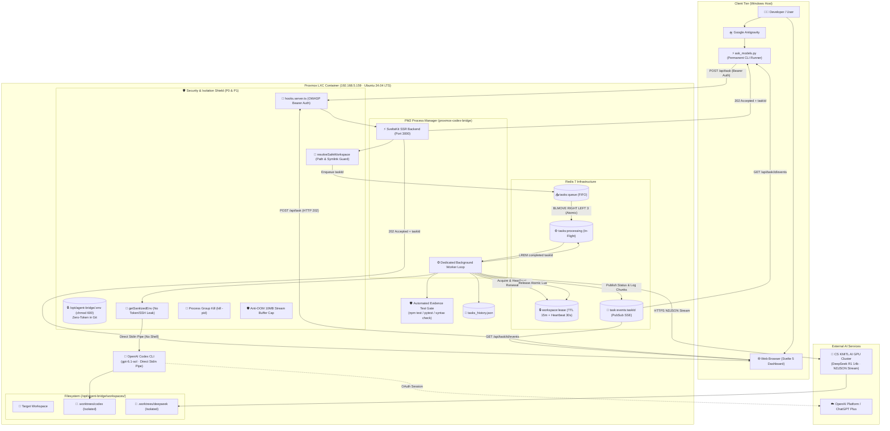
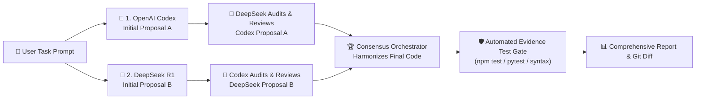

# 🌉 Proxmox Codex Bridge & Multi-Agent Platform

[](https://nodejs.org/)
[](https://redis.io/)
[](https://pm2.keymetrics.io/)
[-orange.svg)](https://chatgpt.com/)
[-purple.svg)](https://aipass.cskmitl.com/)
[-emerald.svg)](#-สถาปัตยกรรมความปลอดภัย-security-architecture--hardening)

ระบบเชื่อมต่อและบริดจ์คำสั่งอัจฉริยะ (Multi-Agent Orchestration Platform) ที่ผสานพลังระหว่าง **Google Antigravity** (บน Windows Host), **OpenAI Codex CLI (`gpt-6.1-sol`)** (บน Proxmox LXC Container) และ **DeepSeek R1 (14b GPU)** (บน CS KMITL AI GPU Cluster) ควบคุมการทำงานด้วย **PM2 Process Manager**, **Redis 7 Job Queue** (`BLMOVE`), ระบบสตรีมมิ่งสด **Server-Sent Events (SSE)**, **Automated Evidence Test Gate**, และ Web Dashboard แบบ Real-time บน Svelte 5

🌐 **Web Dashboard:** [http://192.168.5.159:3000](http://192.168.5.159:3000) *(เข้าถึงผ่านเครือข่ายภายใน)*

---

> [!WARNING]
> **ข้อควรระวังด้านความปลอดภัย:**
> 1. AI Agents และ Test Runner มีความสามารถในการแก้ไขไฟล์และรันคำสั่งภายใต้สิทธิ์ของ Service User บนเซิร์ฟเวอร์
> 2. แนะนำให้รันระบบบน **Unprivileged Proxmox LXC Container (`unprivileged: 1`)** เสมอ เพื่อจำกัดสิทธิ์ไม่ให้กระทบ Proxmox Host
> 3. Git Worktrees ช่วยแยกชุดไฟล์ทดลอง แต่ไม่ใช่ Security Sandbox สำหรับโค้ดที่ไม่น่าไว้วางใจ
> 4. การเปิดใช้งาน API ในเครือข่าย ควรตั้งค่า `BRIDGE_API_KEY` เพื่อบังคับตรวจสิทธิ์ Bearer Token ทุกครั้ง

---

## 📑 สารบัญ (Table of Contents)

1. [🧭 เลือกเส้นทางการอ่าน (Choose Your Path)](#1--เลือกเส้นทางการอ่าน-choose-your-path)
2. [🏗️ สถาปัตยกรรมระบบ (System Architecture)](#2-️-สถาปัตยกรรมระบบ-system-architecture)
3. [📋 ความต้องการของระบบและเวอร์ชันที่ทดสอบ (Requirements)](#3--ความต้องการของระบบและเวอร์ชันที่ทดสอบ-requirements)
4. [🚀 เริ่มต้นใช้งานด่วน (Quick Start)](#4--เริ่มต้นใช้งานด่วน-quick-start)
5. [💻 คู่มือการย้ายหรือตั้งค่า Client เครื่องใหม่ (New Client Machine Setup Guide)](#5--คู่มือการย้ายหรือตั้งค่า-client-เครื่องใหม่-new-client-machine-setup-guide)
6. [🛠️ คู่มือการติดตั้งตั้งแต่ศูนย์บน Proxmox (Server Installation Guide)](#6-️-คู่มือการติดตั้งตั้งแต่ศูนย์บน-proxmox-server-installation-guide)
7. [⚙️ การตั้งค่าระบบและสภาพแวดล้อม (Configuration & .env)](#7-️-การตั้งค่าระบบและสภาพแวดล้อม-configuration---env)
8. [🔑 คู่มือการเปลี่ยน Token และจัดการบัญชี (Token Rotation Guide)](#8--คู่มือการเปลี่ยน-token-และจัดการบัญชี-token-rotation-guide)
9. [💻 คู่มือคำสั่ง CLI Runner (ask_models.py)](#9--คู่มือคำสั่ง-cli-runner-ask_modelspy)
10. [📡 สัญญาการทำงานของ API และ SSE Streaming (API Specification)](#10--สัญญาการทำงานของ-api-และ-sse-streaming-api-specification)
11. [🤖 โหมดการทำงานและระบบ Consensus (Execution Modes & Consensus)](#11--โหมดการทำงานและระบบ-consensus-execution-modes--consensus)
12. [⚡ การทำงานของ Redis 7 Job Queue & Lease Guard](#12--การทำงานของ-redis-7-job-queue--lease-guard)
13. [🛡️ ระบบตรวจสอบหลักฐานอัตโนมัติ (Automated Evidence Test Gate)](#13-️-ระบบตรวจสอบหลักฐานอัตโนมัติ-automated-evidence-test-gate)
14. [🔒 สถาปัตยกรรมความปลอดภัย (Security Architecture & Hardening)](#14--สถาปัตยกรรมความปลอดภัย-security-architecture--hardening)
15. [⚙️ การบริหารจัดการด้วย PM2 (PM2 Operations)](#15-️-การบริหารจัดการด้วย-pm2-pm2-operations)
16. [❓ ตารางวิเคราะห์และแก้ปัญหา (Troubleshooting Matrix)](#16--ตารางวิเคราะห์และแก้ปัญหา-troubleshooting-matrix)
17. [📝 บันทึกประวัติการพัฒนา (Changelog)](#17--บันทึกประวัติการพัฒนา-changelog)

---

## 1. 🧭 เลือกเส้นทางการอ่าน (Choose Your Path)

| กลุ่มผู้ใช้งาน | วัตถุประสงค์ | หัวข้อที่แนะนำให้อ่าน |
|---|---|---|
| **ผู้ใช้งานทั่วไป / นักพัฒนา** | มีระบบติดตั้งอยู่แล้ว ต้องการส่ง Prompt หรือใช้งานผ่าน CLI / Dashboard | [Quick Start](#4--เริ่มต้นใช้งานด่วน-quick-start) → [CLI Runner](#9--คู่มือคำสั่ง-cli-runner-ask_modelspy) → [Troubleshooting](#16--ตารางวิเคราะห์และแก้ปัญหา-troubleshooting-matrix) |
| **ผู้ดูแลระบบ / DevOps** | ติดตั้งระบบใหม่ตั้งแต่ศูนย์ ตั้งค่า Proxmox, Redis, PM2, และเครือข่าย | [Requirements](#3--ความต้องการของระบบและเวอร์ชันที่ทดสอบ-requirements) → [Installation](#6-️-คู่มือการติดตั้งตั้งแต่ศูนย์บน-proxmox-server-installation-guide) → [PM2 Operations](#15-️-การบริหารจัดการด้วย-pm2-pm2-operations) |
| **ความปลอดภัย / Security** | ตรวจสอบมาตรการป้องกัน, Token Isolation, Path Traversal, และ Process Group | [Security Architecture](#14--สถาปัตยกรรมความปลอดภัย-security-architecture--hardening) → [Token Rotation](#8--คู่มือการเปลี่ยน-token-และจัดการบัญชี-token-rotation-guide) |
| **สถาปัตยกรรมซอฟต์แวร์** | ศึกษาระบบ Multi-Agent Consensus, Redis Atomic Queue, และ Real-time SSE | [System Architecture](#2-️-สถาปัตยกรรมระบบ-system-architecture) → [Redis 7 Queue](#12--การทำงานของ-redis-7-job-queue--lease-guard) → [Consensus](#11--โหมดการทำงานและระบบ-consensus-execution-modes--consensus) |

---

## 2. 🏗️ สถาปัตยกรรมระบบ (System Architecture)



---

## 3. 📋 ความต้องการของระบบและเวอร์ชันที่ทดสอบ (Requirements)

| ส่วนประกอบ | เวอร์ชันที่ทดสอบจริง | หน้าที่ในระบบ |
|---|---|---|
| **OS Host** | Windows 11 Pro | เครื่องพัฒนา ทำงานร่วมกับ Google Antigravity |
| **Virtualization** | Proxmox VE 8.x | โฮสต์ควบคุมระบบ Virtualization |
| **LXC Container** | Ubuntu 24.04 LTS (Unprivileged: 1) | สภาพแวดล้อมรัน Backend, Worker, Redis และ Codex CLI |
| **Node.js** | v22.23.4 (LTS) | รัน SvelteKit Dashboard และ Worker Pipeline |
| **Redis Server** | 7.0.15 (Port 6379) | จัดการ Job Queue (`BLMOVE`), PubSub (SSE), และ Lease Locks |
| **Process Manager** | PM2 v5.4.3 | ควบคุมกระบวนการแบบ Daemon, Auto-restart, Memory Cap |
| **Python** | 3.10+ / 3.12+ | รัน `ask_models.py` CLI Runner ฝั่ง Client |
| **Git** | 2.43+ | จัดการ Version Control และ Git Worktree Isolation |
| **Codex CLI** | v0.166.0 (OpenAI) | เชื่อมต่อ ChatGPT Plus โมเดล `gpt-6.1-sol` |
| **DeepSeek Cluster** | CS KMITL AI GPU Cluster | ให้บริการ `deepseek-r1:14b` ผ่าน NDJSON Streaming |

---

## 4. 🚀 เริ่มต้นใช้งานด่วน (Quick Start)

### กรณีที่ 1: ระบบได้รับการติดตั้งแล้ว (ผู้ใช้งานทั่วไป)

1. **ใช้งานผ่าน Web Dashboard:**
   เปิด Browser ไปที่ [http://192.168.5.159:3000](http://192.168.5.159:3000)
   - เลือก Workspace ที่ต้องการ หรือปล่อยเป็น `Auto Temp`
   - เลือกโมเดลที่ต้องการรัน (`Codex`, `DeepSeek`, `Dual Mode`, หรือ `Consensus`)
   - พิมพ์ข้อความสั่งงาน แล้วกด **Run Task**

2. **ใช้งานผ่าน CLI Runner บนเครื่อง Client (Windows / Mac / Linux):**
   - **บน Windows (PowerShell):**
     ```powershell
     # สอบถามหรือสั่งงาน OpenAI Codex (ChatGPT Plus: gpt-6.1-sol)
     python "$HOME/.gemini/config/ask_models.py" --codex "วิเคราะห์โค้ดในโปรเจกต์นี้"

     # สั่งงาน DeepSeek R1 14b บน GPU Cluster
     python "$HOME/.gemini/config/ask_models.py" --deepseek "เขียนฟังก์ชันคำนวณ Fibonacci แบบ DP"

     # สั่งงานแบบ Consensus (Codex + DeepSeek ทำ Peer Review และ Harmonize ร่วมกัน)
     python "$HOME/.gemini/config/ask_models.py" --consensus "ออกแบบ Database Schema สำหรับระบบ E-commerce"
     ```
   - **บน macOS / Linux (Terminal):**
     ```bash
     python3 ~/.gemini/config/ask_models.py --codex "วิเคราะห์โค้ดในโปรเจกต์นี้"
     python3 ~/.gemini/config/ask_models.py --both "เปรียบเทียบคำตอบ 2 โมเดล"
     python3 ~/.gemini/config/ask_models.py --consensus "ออกแบบ Database Schema"
     ```

---

## 5. 💻 คู่มือการย้ายหรือตั้งค่า Client เครื่องใหม่ (New Client Machine Setup Guide)

เมื่อคุณต้องการย้ายไปทำงานบนคอมพิวเตอร์เครื่องใหม่ (เช่น โน้ตบุ๊กเครื่องใหม่, Mac, Linux หรือให้เพื่อนร่วมทีมในวงเน็ตเวิร์กเดียวกันใช้งาน) เครื่องใหม่นั้นต้องการเพียง **Python 3.8+** เท่านั้น โดยไม่ต้องติดตั้ง Node.js หรือ Redis ใดๆ ที่เครื่อง Client

### สิ่งที่ Client เครื่องใหม่ต้องการ:
1. ไฟล์ **CLI Runner (`ask_models.py`)** ติดตั้งอยู่ที่ `~/.gemini/config/ask_models.py`
2. ไฟล์ **Antigravity Rule (`proxmox-codex-bridge.md`)** ติดตั้งอยู่ที่ `~/.gemini/config/rules/proxmox-codex-bridge.md` เพื่อให้ Antigravity ส่งงานเข้า Bridge แทนการจำลองบทบาทเอง
3. สิทธิ์การเข้าถึง IP ของ Proxmox Container ผ่าน LAN หรือ VPN (Tailscale/WireGuard)

---

### วิธีที่ 1: ติดตั้งอัตโนมัติด้วยคำสั่งเดียว (One-Click Setup) [แนะนำที่สุด ⭐]

โคลน Repository มายังเครื่อง Client ใหม่ แล้วรันสคริปต์ `setup_client.py`:

#### บน Windows (PowerShell):
```powershell
git clone https://github.com/techasit5415/proxmox-codex-bridge.git
python proxmox-codex-bridge\scripts\setup_client.py
```

#### บน macOS / Linux (Terminal):
```bash
git clone https://github.com/techasit5415/proxmox-codex-bridge.git
python3 proxmox-codex-bridge/scripts/setup_client.py
```

สคริปต์จะทำการ:
1. สร้างและบันทึกการตั้งค่าถาวร `~/.gemini/config/bridge_config.json` (จำ IP/URL และ API Key อัตโนมัติ)
2. คัดลอก `ask_models.py` และสร้าง Wrapper บน Windows (`ask.bat` & `ask.ps1`)
3. ติดตั้ง Antigravity Rules ใน `GEMINI.md`, `AGENTS.md`, และ `rules/proxmox-codex-bridge.md`
4. ตั้งค่า **Antigravity MCP Server (`mcp_config.json`)** เพื่อให้ Antigravity เรียกใช้ Tool ของ Proxmox ได้โดยตรง
5. ตรวจสอบการเชื่อมต่อ HTTP API และตรวจสอบสิทธิ์ SSH Passwordless Authentication เพื่อความพร้อมใช้งาน 100%

---

### กรณีเปลี่ยน IP, ใช้ Domain หรือใช้งานนอกบ้านผ่าน VPN / Tailscale:

หากเครื่องใหม่เชื่อมต่อผ่าน IP อื่น หรือใช้ Tailscale IP ให้ใส่ Flag `--url`:
```powershell
# ตัวอย่าง: ต่อผ่าน Tailscale IP หรือ IP ใหม่
python proxmox-codex-bridge\scripts\setup_client.py --url http://100.115.92.12:3000

# ตัวอย่าง: หาก Server บังคับใช้ API Key (Bearer Auth)
python proxmox-codex-bridge\scripts\setup_client.py --url http://192.168.5.159:3000 --api-key your_secret_key
```

---

### การตั้งค่า Environment Variables ถาวรบน Client (Optional):

หากคุณไม่ต้องการพิมพ์ Flag URL ทุกครั้ง สามารถตั้งค่าไว้ใน Environment ของเครื่อง Client ได้:

#### บน Windows (PowerShell):
```powershell
# ตั้งค่าถาวรสำหรับ User ปัจจุบัน
[System.Environment]::SetEnvironmentVariable('PROXMOX_BRIDGE_URL', 'http://192.168.5.159:3000/api/task', 'User')
[System.Environment]::SetEnvironmentVariable('BRIDGE_API_KEY', 'your_secret_key', 'User')
```

#### บน macOS / Linux (เพิ่มใน `~/.bashrc` หรือ `~/.zshrc`):
```bash
export PROXMOX_BRIDGE_URL="http://192.168.5.159:3000/api/task"
export BRIDGE_API_KEY="your_secret_key"
```

---

### วิธีที่ 2: ตั้งค่าด้วยตนเอง (Manual Copy):

หากไม่ต้องการรันสคริปต์ สามารถคัดลอกไฟล์ด้วยตนเอง:
1. คัดลอก `scripts/ask_models.py` ไปไว้ที่:
   - Windows: `C:\Users\<username>\.gemini\config\ask_models.py`
   - Mac/Linux: `~/.gemini/config/ask_models.py`
2. คัดลอก `rules/proxmox-codex-bridge.md` ไปไว้ที่:
   - Windows: `C:\Users\<username>\.gemini\config\rules\proxmox-codex-bridge.md`
   - Mac/Linux: `~/.gemini/config/rules/proxmox-codex-bridge.md`

---

## 6. 🛠️ คู่มือการติดตั้งตั้งแต่ศูนย์บน Proxmox (Server Installation Guide)

### ขั้นตอนที่ 1: สร้าง Proxmox LXC Container
1. ในหน้า Proxmox VE Web UI กด **Create CT**
2. เลือก Template: `ubuntu-24.04-standard`
3. ตั้งค่าระบบ:
   - **General:** Uncheck `Privileged container` (ใช้ **Unprivileged Container** เพื่อความปลอดภัย)
   - **Cores:** 2 ถึง 4 Cores
   - **Memory:** 2048 MB (2 GB) ขึ้นไป
   - **Disk:** 8 GB ถึง 16 GB
   - **Network:** กำหนด Static IP (เช่น `192.168.5.159/24`, Gateway: `192.168.5.1`)
4. สตาร์ท Container และเปิด Console

### ขั้นตอนที่ 2: ติดตั้ง Node.js, Redis, และเครื่องมือพื้นฐาน
รันคำสั่งบน Proxmox Container:
```bash
apt update && apt upgrade -y
apt install -y curl git build-essential redis-server python3 python3-pip

# ติดตั้ง Node.js 22.x
curl -fsSL https://deb.nodesource.com/setup_22.x | bash -
apt install -y nodejs

# ติดตั้ง PM2 และ Codex CLI แบบ Global
npm install -g pm2 @openai/codex

# เปิดบริการ Redis Server
systemctl enable --now redis-server
redis-cli ping  # ผลลัพธ์ต้องตอบ PONG
```

### ขั้นตอนที่ 3: ติดตั้งโค้ดโปรเจกต์
```bash
git clone https://github.com/techasit5415/proxmox-codex-bridge.git /opt/agent-bridge
cd /opt/agent-bridge
mkdir -p workspaces logs

# ติดตั้ง Dependencies และ Build Dashboard
cd /opt/agent-bridge/dashboard
npm install
npm run build
```

### ขั้นตอนที่ 4: สร้างไฟล์ Configuration `.env`
สร้างไฟล์ความลับเฉพาะเครื่อง (ห้ามนำเข้า Git):
```bash
cat << 'EOF' > /opt/agent-bridge/.env
PORT=3000
HOST=0.0.0.0
NODE_ENV=production
REDIS_HOST=127.0.0.1
REDIS_PORT=6379
WORKSPACES_DIR=/opt/agent-bridge/workspaces
KMITL_TOKEN=ใส่_token_ของ_cskmitl_ที่นี่
# BRIDGE_API_KEY=ใส่_secret_key_หากต้องการบังคับ_auth
EOF

# กำหนดสิทธิ์เข้มงวด เฉพาะ root เท่านั้นที่อ่านได้
chmod 600 /opt/agent-bridge/.env
```

### ขั้นตอนที่ 5: เริ่มต้นระบบด้วย PM2 และตั้งค่า Auto-start ตอนบูต
```bash
cd /opt/agent-bridge
pm2 start ecosystem.config.cjs
pm2 save
pm2 startup systemd  # ทำตามคำสั่งที่ระบบแจ้งเพื่อผูกเข้า systemd boot
```

### ขั้นตอนที่ 6: ล็อกอิน OpenAI Codex CLI
```bash
codex login
# เปิดลิงก์ URL ที่แสดงบนจอใน Browser เพื่อยืนยันสิทธิ์ ChatGPT Plus
codex login status  # ตรวจสอบสถานะว่าแสดง Logged in
```

### ขั้นตอนที่ 7: ตั้งค่า CLI Runner บน Windows Host
คัดลอกไฟล์ `scripts/ask_models.py` มาไว้ที่ `C:\Users\<username>\.gemini\config\ask_models.py` เพื่อให้ Antigravity และคุณเรียกใช้งานได้จากทุกที่

---

## 7. ⚙️ การตั้งค่าระบบและสภาพแวดล้อม (Configuration & .env)

ไฟล์ `.env` จริงจะเก็บไว้ที่ `/opt/agent-bridge/.env` (และถูกละเว้นโดย `.gitignore` 100%):

| ตัวแปร Environment | ค่าเริ่มต้น | ความจำเป็น | คำอธิบาย |
|---|---|---|---|
| `PORT` | `3000` | ตัวเลือก | พอร์ตที่ Web Dashboard ให้บริการ |
| `HOST` | `0.0.0.0` | ตัวเลือก | ไอพีที่รับการเชื่อมต่อ (`0.0.0.0` สำหรับทุกอินเทอร์เฟซ) |
| `NODE_ENV` | `production` | จำเป็น | โหมดการทำงานของ Node.js |
| `REDIS_HOST` | `127.0.0.1` | จำเป็น | ที่อยู่ของ Redis Server |
| `REDIS_PORT` | `6379` | จำเป็น | พอร์ตของ Redis Server |
| `WORKSPACES_DIR` | `/opt/agent-bridge/workspaces` | จำเป็น | ไดเรกทอรีรากสำหรับเก็บไฟล์โค้ดของงานทั้งหมด |
| `KMITL_TOKEN` | - | จำเป็น | Bearer Token สำหรับเข้าถึง CS KMITL AI GPU Cluster |
| `BRIDGE_API_KEY` | *(ว่าง)* | ตัวเลือก | รหัสผ่านลับสำหรับครอบสิทธิ์ API (Bearer Authentication) |

> [!NOTE]
> ไฟล์ `ecosystem.config.cjs` จะอ่านไฟล์ `.env` เข้าหน่วยความจำของ PM2 ตอนเริ่มต้น Service โดยตรง หากมีการแก้ไขไฟล์ `.env` ให้สั่ง `pm2 restart proxmox-codex-bridge --update-env` เสมอ

---

## 8. 🔑 คู่มือการเปลี่ยน Token และจัดการบัญชี (Token Rotation Guide)

### 8.1 วิธีเปลี่ยน `KMITL_TOKEN` (DeepSeek R1 GPU Cluster)
1. SSH เข้าไปยัง Proxmox Container:
   ```bash
   ssh root@192.168.5.159
   ```
2. แก้ไขไฟล์ `.env`:
   ```bash
   nano /opt/agent-bridge/.env
   ```
   เปลี่ยนค่า `KMITL_TOKEN=gpu_token_ใหม่` แล้วกด `Ctrl + O` บันทึก และ `Ctrl + X` ออก
3. สั่งให้ PM2 อัปเดต Environment ทันที:
   ```bash
   pm2 restart proxmox-codex-bridge --update-env
   ```

### 8.2 วิธีเปลี่ยนหรือตั้งค่า `BRIDGE_API_KEY` (API Authentication)
1. แก้ไขไฟล์ `/opt/agent-bridge/.env`:
   ```ini
   BRIDGE_API_KEY=รหัสผ่านลับใหม่ที่คุณต้องการ
   ```
2. รีสตาร์ท PM2:
   ```bash
   pm2 restart proxmox-codex-bridge --update-env
   ```
3. บนเครื่อง Windows ตั้งค่า Environment Variable ใน PowerShell เพื่อให้ `ask_models.py` ใช้งานได้:
   ```powershell
   $env:BRIDGE_API_KEY="รหัสผ่านลับใหม่ที่คุณต้องการ"
   ```

### 8.3 วิธี Re-login / เปลี่ยนบัญชี OpenAI Codex (ChatGPT Plus)
```bash
ssh root@192.168.5.159
codex logout
codex login
# ทำตามขั้นตอนบนหน้าจอเพื่อผูกบัญชี ChatGPT Plus ใหม่
codex login status
```

---

## 9. 💻 คู่มือคำสั่ง CLI Runner (ask_models.py)

ไฟล์ `ask_models.py` รองรับการรับคำสั่งทั้งแบบข้อความตรงๆ หรือส่ง Path ของไฟล์ Text:

```bash
python scripts/ask_models.py [MODE] [--workspace NAME] [--sync] "<PROMPT หรือ PATH_TO_FILE>"
```

### สรุปตัวเลือกคำสั่ง (CLI Flags)

| Flag | คำอธิบาย | ตัวอย่างการใช้งาน |
|---|---|---|
| `--codex` | ส่งคำสั่งให้ **OpenAI Codex (`gpt-6.1-sol`)** เท่านั้น | `python ask_models.py --codex "สรุปหลักการ REST API"` |
| `--deepseek` | ส่งคำสั่งให้ **DeepSeek R1 (14b GPU)** เท่านั้น | `python ask_models.py --deepseek "สร้าง Binary Search ใน Python"` |
| `--both` | รันทั้งสองโมเดลพร้อมกันแบบขนาน (แยก Git Worktrees) | `python ask_models.py --both "เปรียบเทียบข้อดีของ Redis vs PostgreSQL"` |
| `--consensus` | รันระบบ Multi-Agent Consensus (Bilateral Review + Harmonize) | `python ask_models.py --consensus "ออกแบบระบบ Notification System"` |
| `--workspace` | กำหนดชื่อ Workspace ปลายทาง (หากไม่ระบุจะใช้ `auto-temp`) | `python ask_models.py --codex --workspace my-project "แก้ bug หน้า login"` |
| `--sync` | รันแบบ Synchronous ตรง ไม่ผ่าน Redis Queue | `python ask_models.py --codex --sync "ทดสอบแบบด่วน"` |

---

## 10. 📡 สัญญาการทำงานของ API และ SSE Streaming (API Specification)

### 10.1 ส่งคำสั่งสร้างงาน (`POST /api/task`)
- **Headers:** `Content-Type: application/json` และ `Authorization: Bearer <BRIDGE_API_KEY>` (หากเปิด Auth)
- **Request Body:**
  ```json
  {
    "provider": "codex",       // "codex" | "deepseek" | "both" | "consensus"
    "prompt": "เนื้อหาคำสั่งงาน",
    "workspace": "my-project"   // หรือ "auto-temp"
  }
  ```
- **Response (HTTP 202 Accepted):**
  ```json
  {
    "success": true,
    "taskId": "task_1793698546996_4s7iu",
    "status": "queued",
    "message": "Task queued in Redis. Stream live updates at /api/task/task_1793698546996_4s7iu/events"
  }
  ```

### 10.2 สตรีมผลลัพธ์สดเรียลไทม์ (`GET /api/task/[id]/events`)
- **Format:** Server-Sent Events (`text/event-stream`)
- **Event Types:**
  - `status`: การเปลี่ยนสถานะของงาน (`queued` -> `running` -> `completed` / `failed`)
  - `stage`: ขั้นตอนปัจจุบัน (เช่น `Executing Codex...`, `Running Evidence Test Gate...`)
  - `log`: ข้อความ Log chunks แบบสด
  - `done`: งานเสร็จสิ้น ส่งผลลัพธ์และ Test Evidence ทั้งหมด
  - `error`: งานล้มเหลว พร้อมข้อความสาเหตุ

---

## 11. 🤖 โหมดการทำงานและระบบ Consensus (Execution Modes & Consensus)



1. **Phase 1: Dual Proposal Generation** — ทั้งสองโมเดลได้รับโจทย์เดียวกัน และคิดค้นวิธีการแก้ปัญหาอย่างอิสระบน Git Worktree ของตนเอง
2. **Phase 2: Bilateral Cross Peer Review** — DeepSeek R1 ทำหน้าที่ Audit โค้ดของ Codex พร้อมชี้จุดบกพร่อง (ผ่าน NDJSON Streaming `stream: true` ป้องกัน Nginx 504 Timeout) ในขณะที่ Codex ตรวจสอบโค้ดของ DeepSeek เพื่อหาช่องโหว่
3. **Phase 3: Final Harmonization** — นำข้อเสนอแนะและจุดแข็งของทั้งสองฝั่งมาสังเคราะห์เป็นโค้ดสุดท้ายที่สมบูรณ์ที่สุด
4. **Phase 4: Automated Test Gate** — ตรวจสอบความถูกต้องของโค้ดด้วย Test Suite หรือ Syntax Verification อัตโนมัติ

### 11.1 🌐 ระบบ DeepSeek R1 ReAct Web Agent & GitHub Auto Pre-Fetcher (`taskRunner.ts`)
เพื่อให้ **DeepSeek R1 (`14b` บน KMITL GPU)** สามารถเข้าถึงข้อมูลจากอินเทอร์เน็ตและอ่านไฟล์ใน Repository ได้ทัดเทียมกับ OpenAI Codex ระบบจึงมี 2 กลไกอัตโนมัติ:

1. **Auto Pre-Fetcher (ดึงลิงก์ GitHub & เว็บไซต์ก่อนเริ่มงานอัตโนมัติ):**
   - **ตรวจพบลิงก์ GitHub (`https://github.com/<owner>/<repo>`):** หากอยู่ในโหมด `auto-temp` ระบบจะสั่ง `git clone --depth 1` ลงใน Workspace ให้ก่อนเริ่มงานอัตโนมัติ และสร้าง **Workspace Context Snapshot** (`buildWorkspaceSnapshot`) ดึงโครงสร้างไฟล์ (`git ls-files`), `README.md` และไฟล์โค้ดหลักแนบเข้า Prompt ให้ DeepSeek เห็นทันที (และช่วยให้ Codex เห็นไฟล์ใน Workspace เดียวกันโดยไม่ต้องสั่ง `git clone` ซ้ำใน `/tmp`)
   - **ตรวจพบลิงก์เว็บไซต์ทั่วไป (`https://...`):** ระบบจะดึงเนื้อหาหน้าเว็บผ่าน **Jina Reader (`https://r.jina.ai/...`)** พร้อม HTML-to-Text Fallback และแนบเนื้อหาเข้า Prompt ให้ DeepSeek วิเคราะห์ได้ทันที
2. **Multi-Turn ReAct Agent Loop (สูงสุด 3 รอบ):**
   DeepSeek R1 สามารถเรียกใช้เครื่องมือ (Tools) บน Proxmox CT ได้โดยตรงผ่านคำสั่ง:
   - `[TOOL:WEB_SEARCH] <คำค้นหา>` — ค้นหาข้อมูลสดจากอินเทอร์เน็ตผ่าน DuckDuckGo Lite (`https://lite.duckduckgo.com/lite/`)
   - `[TOOL:FETCH_URL] <https://...>` — เปิดอ่านเนื้อหาจาก URL ที่ต้องการ (ป้องกัน SSRF ด้วย `isSafePublicUrl`)
   - `[TOOL:READ_FILE] <relative/path>` — เปิดอ่านไฟล์โค้ดภายใน Workspace (ป้องกัน Path Traversal / Symlink Escape ด้วย `safeReadWorkspaceFile`)
   - `[TOOL:LIST_FILES]` — ดูรายชื่อไฟล์ทั้งหมดใน Workspace
3. **ขยาย Context Window 4x (`num_ctx: 16384`) & Always-Stream (`stream: true`):**
   ส่งพารามิเตอร์ `options: { num_ctx: 16384 }` ไปยัง Ollama API ของ KMITL เพื่อขยายความจำจาก 4,096 เป็น 16,384 tokens (แก้ปัญหา HTTP 400 Context Overflow) และบังคับใช้ `stream: true` ในทุกขั้นตอน (แก้ปัญหา Nginx ตัดสาย 504 Gateway Time-out ขณะโมเดลคิด `<think>` นานๆ)

### 11.2 📊 ระบบคำนวณ Net Tokens & การลดการกิน Token ของ Codex
- **แยก `Net Tokens` ออกจาก `Cached Tokens`:** OpenAI Codex CLI รายงาน `total_tokens` โดยรวม `cached_input_tokens` (ซึ่งคิดเป็น ~85% ของทั้งหมดจากการอ่านไฟล์ซ้ำใน Agent Loop) ระบบจึงคำนวณ **`net_tokens = total_tokens - cached_input_tokens`** และแสดงผลคู่กันทั้งบน Header (`Net Tok`), แถบ History, และ CLI (`ask_models.py`)
- **แยกประเภทงานวิเคราะห์ (`detectTaskType` ใน `types.ts`):** คำสั่งประเภทถาม-ตอบ อธิบาย วิเคราะห์ หรือสรุป (`อธิบาย`, `วิเคราะห์`, `สรุป`, `เปรียบเทียบ`) จะถูกจัดเป็นโหมด `general` (Analysis) และสั่งห้าม Codex รันเชลล์สแกนไฟล์หรือโคลน Repo ซ้ำในรอบ Peer Review / Harmonization ช่วยลดการใช้ Token ลง 60–70%

---

## 12. ⚡ การทำงานของ Redis 7 Job Queue & Lease Guard

### 12.1 คำสั่ง Atomic Queue Transition (`BLMOVE`)
ระบบใช้คำสั่งของ Redis 7 ในการส่งต่องานจากคิวรอไปสู่คิวกำลังประมวลผล:
```redis
BLMOVE tasks:queue tasks:processing RIGHT LEFT 3
```
- **ประโยชน์:** ปิดช่องว่างที่งานจะสูญหาย (Zero Crash Window) หาก Worker เกิดแครชระหว่างรับงาน งานจะไม่หลุดออกจากระบบ
- **Crash Recovery (`recoverOrphanedTasks`):** เมื่อ Worker เริ่มทำงานใหม่ จะสแกน `tasks:processing` หากพบงานที่ไม่มี Lease ถือครองอยู่ จะปรับสถานะเป็น `failed` พร้อมระบุสาเหตุ เพื่อให้ระบบตรวจสอบย้อนหลังได้

### 12.2 Workspace Lease Guard & Heartbeat Renewal
- เมื่อเริ่มรันงาน ระบบจะสร้าง Lease Lock ใน Redis: `workspace:lease:<workspace_name>` ด้วยค่า TTL 15 นาที
- **Heartbeat Renewal:** ระหว่างที่งานยังประมวลผลอยู่ Worker จะส่งคำสั่ง Lua Script ต่ออายุ TTL อัตโนมัติทุกๆ 30 วินาที ป้องกัน Lease หมดอายุระหว่างรันงานที่ซับซ้อน
- **Atomic Release:** เมื่อเสร็จสิ้น จะปลดล็อคด้วย Atomic Lua Script ที่เปรียบเทียบ Token ป้องกันการลบ Lock ของผู้อื่น
- **Safe Protection:** ปุ่ม Delete Workspace และ Clean Temp จะถูกบล็อคด้วยรหัส **HTTP 409 Conflict** ทันทีหาก Workspace นั้นมีงานรันอยู่

---

## 13. 🛡️ ระบบตรวจสอบหลักฐานอัตโนมัติ (Automated Evidence Test Gate)

ระบบจะตรวจสอบโค้ดที่โมเดลแก้ไขโดยอัตโนมัติก่อนส่งมอบงาน:

```markdown
| ประเภทการตรวจ | คำสั่งที่ระบบเรียกใช้ | เกณฑ์การประเมิน |
|---|---|---|
| **Automated Test Suite** | `npm test` หรือ `pytest -q` / `python3 -m unittest` | รันชุดทดสอบจริง หาก Test ผ่านจะบันทึกสถานะ Test Gate: PASSED |
| **Automated Syntax Verification** | `node --check <file>` หรือ `python3 -m py_compile <file>` | ตรวจสอบ Syntax และไวยากรณ์ของโค้ดที่ถูกแก้ ไม่แสดงอ้างว่าผ่าน Unit Tests |
| **Not Detected / Clean** | ไม่มีไฟล์ Script ทดสอบใน Workspace | แสดงสถานะ No test suite detected ชัดเจน |
```

- ผลลัพธ์การทดสอบจะถูกแนบเป็นหลักฐาน (Command, Output, Exit Code) ใน Web Dashboard และรายงานส่งออก

---

## 14. 🔒 สถาปัตยกรรมความปลอดภัย (Security Architecture & Hardening)

ระบบได้รับการ Audit ซ้ำ 3 รอบโดย **ChatGPT (`gpt-6.1-sol`)** และได้รับการปรับปรุงความปลอดภัยระดับ Enterprise (P0 & P1 Hardening):

| มาตรการความปลอดภัย | การทำงานในโค้ด | ประโยชน์และการป้องกัน |
|---|---|---|
| **Zero-Token in Git** | แยกความลับลง `/opt/agent-bridge/.env` (chmod 600) | ไม่มี API Token ใดๆ หลุดเข้าไปใน Git Repository 100% |
| **Subprocess Sanitization** | `getSanitizedEnv()` ใน `taskRunner.ts` | ตัด `KMITL_TOKEN`, `BRIDGE_API_KEY`, และ `SSH_AUTH_SOCK` ไม่ให้ Child Process หรือ Test Scripts ขโมยไปได้ |
| **Path Traversal Guard** | `resolveSafeWorkspace()` ด้วย `path.relative` | ป้องกันการใช้ `../` หรือ Directory Sibling Prefix เพื่อหลุดออกนอกโฟลเดอร์ |
| **Canonical Symlink Guard** | ตรวจ `fs.realpathSync(target)` ใน `resolveSafeWorkspace` | สกัดกั้นการสร้าง Symbolic Link ภายใน Workspace ที่ชี้ออกไปยัง `/etc` หรือ Host Root |
| **Direct Stdin Piping** | `spawn` พร้อม `shell: false` และ Stdin Pipe | ขจัดปัญหา Shell Metacharacter Injection (`;`, `&&`, `|`, `` ` ``) สิ้นเชิง และไม่สร้างไฟล์ชั่วคราวใน `/tmp` |
| **Process Group Kill** | `detached: true` และ `process.kill(-child.pid)` | กวาดล้างทั้งโปรเซสแม่และลูกหลาน (Grandchildren) ทั้งหมดเมื่อเกิด Timeout ป้องกัน Zombie Processes |
| **Anti-OOM Buffer Cap** | จำกัด Logs ที่ 10MB (`MAX_OUTPUT_BYTES`) พร้อม Drain Stream | ป้องกัน Node.js หน่วยความจำเต็ม (OOM) เมื่อคำสั่งพ่น Output ปริมาณมหาศาล |
| **OWASP Bearer Auth** | บังคับส่ง Header `Authorization: Bearer <token>` | ตัดการรับ Token ผ่าน URL Query String (`?key=`) ป้องกัน Token รั่วใน Web Logs |
| **SSRF Guard สำหรับ Web Agent** | `isSafePublicUrl()` ใน `taskRunner.ts` | บล็อคการดึง URL ที่ชี้ไปยัง `localhost`, `127.0.0.1`, `10.x`, `172.16-31.x`, `192.168.x`, `169.254.x` และ `.local`/`.internal` ป้องกัน DeepSeek ถูกหลอกให้ยิงหา Internal Network |
| **Safe Workspace File Reader** | `safeReadWorkspaceFile()` ใน `taskRunner.ts` | บังคับตรวจ `path.resolve` และ `fs.realpathSync` ก่อนอนุญาตให้ `[TOOL:READ_FILE]` ของ DeepSeek อ่านไฟล์ภายใน Workspace เท่านั้น |

---

## 15. ⚙️ การบริหารจัดการด้วย PM2 (PM2 Operations)

ระบบ Backend และ Worker ควบคุมการทำงานผ่าน **PM2** ภายใต้ชื่อ `proxmox-codex-bridge`:

```bash
# ตรวจสอบสถานะการทำงาน หน่วยความจำ และ CPU
pm2 status

# ดู Logs สดแบบ Real-time
pm2 logs proxmox-codex-bridge

# ดู Logs ย้อนหลัง 100 บรรทัดล่าสุด (ไม่ Stream)
pm2 logs proxmox-codex-bridge --lines 100 --nostream

# รีสตาร์ท Service พร้อมโหลด Environment (.env) ใหม่
pm2 restart proxmox-codex-bridge --update-env

# บันทึกสถานะ Service ปัจจุบันสำหรับบูตเครื่อง
pm2 save
```

- **Structured Logs:** บันทึกแยกไฟล์ชัดเจนที่ `/opt/agent-bridge/logs/pm2-out.log` และ `/opt/agent-bridge/logs/pm2-error.log`
- **Memory Threshold:** ตั้งค่า `max_memory_restart: '600M'` ใน `ecosystem.config.cjs` หากโปรเซสใช้แรมเกินจะถูก Restart อัตโนมัติ

---

## 16. ❓ ตารางวิเคราะห์และแก้ปัญหา (Troubleshooting Matrix)

| ปัญหาที่พบ | สาเหตุที่เป็นไปได้ | วิธีตรวจสอบอย่างปลอดภัย | วิธีแก้ไข |
|---|---|---|---|
| **API ตอบ 401 Unauthorized** | ไม่ได้ส่ง Bearer Header หรือ Key ใน `.env` ไม่ตรง | ตรวจสอบตัวแปร `BRIDGE_API_KEY` ใน `.env` | ส่ง Header `Authorization: Bearer <key>` ให้ถูกต้อง |
| **ส่งงานแล้วได้ 202 แต่งานไม่เริ่ม** | PM2 Worker หยุดทำงาน หรือ Redis ค้าง | ตรวจ `pm2 status` และ `redis-cli ping` | สั่ง `pm2 restart proxmox-codex-bridge` |
| **ลบ Workspace แล้วตอบ 409 Conflict** | มี Task กำลังประมวลผลและถือ Lease Lock อยู่ | ตรวจสอบหน้า Dashboard แถบ Active Tasks | รองานทำงานเสร็จ หรือรอจนหมดช่วง Lease |
| **DeepSeek แจ้ง Unauthorized (401)** | `KMITL_TOKEN` ใน `.env` หมดอายุหรือไม่ถูกต้อง | ตรวจสอบ Log ใน `/opt/agent-bridge/logs/pm2-error.log` | นำ Token ใหม่มาใส่ใน `.env` แล้วสั่ง `pm2 restart ... --update-env` |
| **Codex CLI แจ้ง Not Logged In** | Session ของ ChatGPT Plus หมดอายุ | รัน `codex login status` บน Container | รัน `codex login` เพื่อยืนยันสิทธิ์ OAuth ใหม่ |
| **SSE สตรีมมิ่งไม่แสดงผลบน Browser** | Reverse Proxy บัฟเฟอร์ข้อความไว้ | ตรวจสอบการตั้งค่า Nginx (ต้องการ `proxy_buffering off;`) | ปิด Buffering บน Reverse Proxy |
| **Output Log มีข้อความ Truncated** | โปรแกรมพ่นข้อมูลออกมาเกิน 10MB | ตรวจสอบขนาด Log ใน Test Evidence | ปรับคำสั่งใน Test ให้เป็นแบบย่อ (Quiet mode เช่น `pytest -q`) |
| **Service ไม่เริ่มทำงานหลัง Reboot Proxmox** | ยังไม่ได้ผูกคำสั่ง systemd startup ของ PM2 | รัน `systemctl status pm2-root` | รัน `pm2 startup systemd` และ `pm2 save` |

---

## 17. 📝 บันทึกประวัติการพัฒนา (Changelog)

### v2.3.0 (DeepSeek Web Agent, Auto Pre-Fetcher, Net Token Tracking & Consensus UX Overhaul)
สรุปรายละเอียดการแก้ไขแยกตามไฟล์และส่วนประกอบ (`แก้ไรไปส่วนไหน`):

| ไฟล์ที่แก้ไข | ส่วนประกอบ | รายละเอียดการแก้ไข |
|---|---|---|
| `dashboard/src/lib/taskRunner.ts` | **DeepSeek Engine & Pre-Fetcher** | • สร้าง `callKmitlDeepSeekStream()` ใช้ `stream: true` และ `options: { num_ctx: 16384 }` ทั้งรอบแรกและรอบ Peer Review แก้ปัญหา **504 Gateway Time-out** และ **400 Context Overflow (4096 tokens)**<br>• เพิ่ม `autoCloneGitHubRepoIfNeeded()` และ `buildWorkspaceSnapshot()` โคลนลิงก์ GitHub อัตโนมัติและดึงโครงสร้างโค้ดให้ทั้ง DeepSeek & Codex<br>• เพิ่ม `prefetchPromptWebUrls()`, `fetchWebPageText()`, `searchWebDuckDuckGo()` และ **ReAct Agent Loop** (`[TOOL:WEB_SEARCH]`, `[TOOL:FETCH_URL]`, `[TOOL:READ_FILE]`, `[TOOL:LIST_FILES]`) พร้อม `isSafePublicUrl()` (SSRF Guard) และ `safeReadWorkspaceFile()`<br>• เพิ่มคำสั่งจำกัดการรันเชลล์ซ้ำของ Codex ในรอบ Peer Review / Harmonization และปรับ `runTestGate()` ให้รองรับ `unittest discover -s tests` |
| `dashboard/src/lib/types.ts` | **Token Math & Task Classifier** | • เพิ่มฟิลด์ `net_tokens`, ฟังก์ชัน `getNetTokens()`, `fmtTokenBadge()` แยก Token ที่ประมวลผลจริงออกจาก `cached_input_tokens`<br>• ปรับปรุง `detectTaskType()` ให้แยกงานวิเคราะห์/สรุป (`general`) ออกจากงานเขียน/แก้ไฟล์โค้ด (`code`) อย่างแม่นยำ<br>• เพิ่ม `diskFree`, `diskPercent`, `processingCount` ใน `SystemStatus` |
| `dashboard/src/routes/api/status/+server.ts` | **System Status API (Queue & Disk)** | • ดึงข้อมูลพื้นที่ดิสก์คงเหลือ (`diskFree`), เปอร์เซ็นต์ที่ใช้ (`diskPercent`) จาก `df -h /`<br>• ดึงจำนวนงานที่กำลังรันจริง (`processingCount` จาก `tasks:processing`) คู่กับคิวรอ (`queueLength` จาก `tasks:queue`)<br>• คำนวณ `netTokens` รวมจากทุก Session ของ Codex |
| `dashboard/src/lib/components/Header.svelte` | **Top Status Bar UI** | • แสดงป้ายสถานะ **คิวงานสด (`คิว: X รอ · Y รัน`)** และ **พื้นที่ดิสก์คงเหลือ (`พท.เหลือ: XXG`)** คู่กับ `RAM` และ `Net Tok` แบบ Real-time |
| `dashboard/src/routes/+page.svelte` | **Main State & Refresh Fix** | • แก้บั๊ก `onMount` และ `fetchWorkspaces` ที่เคยบังคับเลือก `workspaces[0]` (`Android-Tv`) ทุกครั้งที่ Refresh หน้าเว็บ ให้คงสถานะเริ่มต้นที่ `'all'` (`Auto Temp` / ไม่เลือกโปรเจกต์) เสมอ |
| `dashboard/src/lib/components/WorkspaceSidebar.svelte` | **Workspace Navigation UI** | • แยก **โปรเจกต์หลัก** ออกจากโฟลเดอร์ชั่วคราว และยุบรวมโฟลเดอร์ `temp-*` ไว้ใน **Collapsible Accordion** ที่พับเก็บเป็นค่าเริ่มต้น เพื่อไม่ให้ดันกล่อง `History` ตกขอบจอ |
| `dashboard/src/lib/components/HistorySidebar.svelte` | **History Search & Filter UI** | • เพิ่มช่องค้นหาประวัติ (`ค้นหาประวัติแชท หรือคำสั่ง...`), ปุ่ม `+ งานใหม่`, แสดง `Net Tokens` และตัดคำนำหน้า `temp-` ให้อ่านง่าย |
| `dashboard/src/lib/components/TaskInput.svelte` | **Prompt Composer UI** | • เพิ่มป้ายแสดง **พื้นที่รันงาน (`Auto Temp` หรือชื่อโปรเจกต์)** พร้อม Dropdown สลับโปรเจกต์ด่วนในกล่อง Prompt, คำอธิบายแต่ละโหมด AI และซ่อนช่อง `Branch: auto` ไว้ในปุ่มย่อ |
| `dashboard/src/lib/components/ResultsViewer.svelte` | **Empty State & Quick Starters** | • เปลี่ยนหน้าว่าง (`Waiting for execution...`) เป็นหน้า **"วันนี้อยากให้ช่วยอะไร?"** พร้อมการ์ดเทมเพลตเริ่มต้นด่วน 4 รูปแบบ และรายการเปิดดูงานล่าสุด 4 งาน |
| `scripts/ask_models.py` | **CLI Bridge Runner** | • แสดงผล `Net Tokens` คู่กับ `Total / Cached / Output Tokens` ใน Terminal |

### v2.2.0 (Security & Architecture Hardening - Post Audit)
- 🛡️ **P0 Hardening:** เพิ่ม Canonical Realpath Symlink Guard ป้องกัน Symlink Escape
- 🧹 **P0 Hardening:** ตัด `SSH_AUTH_SOCK` และ `CODEX_CONFIG_DIR` ออกจากการสืบทอดไปยัง Subprocesses
- 🔒 **P0 Hardening:** ยกเลิกการรับ Key ผ่าน URL (`?key=`) บังคับใช้เฉพาะ Bearer Header ตามมาตรฐาน OWASP
- 🌲 **P0 Hardening:** ปรับใช้ Process Group (`detached: true` + `kill -pid`) กำจัด Grandchildren / Zombie
- ⚡ **P1 Hardening:** เปลี่ยนมาใช้คำสั่ง Redis 7 `BLMOVE` แบบ Atomic Queue-to-Processing
- 🔄 **P1 Hardening:** เพิ่มระบบ `recoverOrphanedTasks` กู้คืนงานที่ค้างตอนบูตระบบอย่างปลอดภัย
- 🛡️ **P1 Hardening:** จำกัดเพดาน Memory Buffer ที่ 10MB พร้อมระบบ Stream Draining ป้องกัน Node.js OOM

### v2.1.0 (Job Queue & PM2 Process Management)
- ⚡ ติดตั้งระบบ Redis 7 Job Queue รองรับงานแบบ Asynchronous (HTTP 202 Accepted + taskId)
- 📡 เพิ่มระบบ Server-Sent Events (SSE) ผ่าน Redis PubSub สตรีมมิ่ง Logs และสถานะแบบสด
- 🔒 สร้างระบบ Workspace Lease Guard พร้อม Heartbeat Renewal และ Atomic Lua Release
- ⚙️ ย้ายการจัดการ Service ทั้งหมดขึ้นควบคุมด้วย PM2 (`ecosystem.config.cjs`) พร้อม Memory Cap 600M
- 🛡️ เพิ่ม Automated Evidence Test Gate แยกประเภท Test Suite และ Syntax Verification

### v2.0.0 (Multi-Agent Consensus Platform)
- 🤝 เปิดตัวระบบ Multi-Agent Consensus Loop (Bilateral Peer Review ระหว่าง Codex และ DeepSeek)
- 🌲 เพิ่มระบบ Git Worktree Isolation สำหรับการทดสอบโค้ดแบบขนาน (Dual Model Compare)
- 🌐 อัปเกรดหน้า Web Dashboard สู่ Svelte 5 Runes พร้อมระบบ Export รายงานแบบ Markdown, Git Patch และ JSON

---

## 📄 ลิขสิทธิ์ (License)

โครงการนี้เผยแพร่ภายใต้ [MIT License](LICENSE) สามารถนำไปใช้งาน ปรับแต่ง และพัฒนาต่อได้อย่างอิสระ
