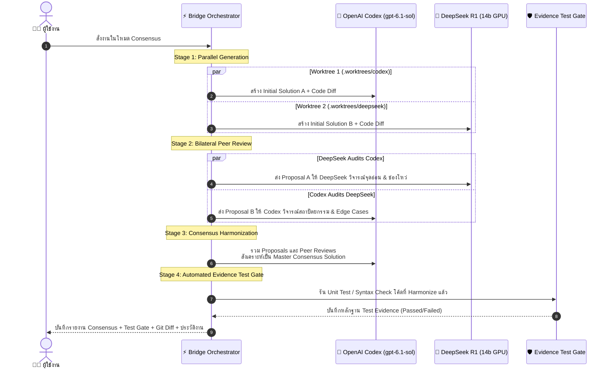

# 🌉 Proxmox Codex Bridge & Multi-Agent Platform

ระบบเชื่อมต่อและบริดจ์คำสั่งอัจฉริยะ (Multi-Agent Bridge) ที่ผสานการทำงานระหว่าง **Google Antigravity**, **OpenAI Codex (gpt-6.1-sol)** บน Proxmox LXC Container และ **DeepSeek R1 (14b GPU)** บน CS KMITL GPU Cluster พร้อม **Redis 7 Job Queue & Worker**, ระบบสตรีมมิ่งสด **Server-Sent Events (SSE)**, **Automated Evidence Test Gate**, และ Web Dashboard ควบคุมแบบ Real-time บน Svelte 5

🌐 **Web Dashboard:** [http://192.168.5.159:3000](http://192.168.5.159:3000) (เข้าถึงผ่านเครือข่ายภายใน)

---

## 📑 สารบัญ (Table of Contents)
- [🏗️ สถาปัตยกรรมระบบ (System Architecture)](#️-สถาปัตยกรรมระบบ-system-architecture)
- [🚀 ฟีเจอร์หลัก (Core Features)](#-ฟีเจอร์หลัก-core-features)
- [1. 🧩 โครงสร้าง 11 Modular Components (Svelte 5 Runes)](#1--โครงสร้าง-11-modular-components-svelte-5-runes)
- [2. 🗂️ ระบบ Auto Temp Workspace และการจัดการพื้นที่](#2-️-ระบบ-auto-temp-workspace-และการจัดการพื้นที่)
- [3. 🎯 Task Intent Detection (Code vs General / Planning)](#3--task-intent-detection--code-vs--general--planning)
- [4. 🛡️ กฎเหล็ก Anti-Hallucination & Multi-Agent Strict Policy](#4-️-กฎเหล็ก-anti-hallucination--multi-agent-strict-policy)
- [5. 🌲 Dual Compare View & Git Worktree Isolation](#5--dual-compare-view--git-worktree-isolation)
- [6. 🤝 Multi-Agent Consensus Loop (Bilateral Peer Review)](#6--multi-agent-consensus-loop-bilateral-peer-review)
- [7. ⚡ Redis 7 Job Queue, Worker & Safe Workspace Lease](#7--redis-7-job-queue-worker--safe-workspace-lease)
- [8. 🛡️ Automated Evidence Test Gate (Evidence-Based Testing)](#8-️-automated-evidence-test-gate-evidence-based-testing)
- [9. 📡 Real-time SSE Streaming & Report Export](#9--real-time-sse-streaming--report-export)
- [🛠️ การติดตั้งและการเชื่อมต่อ (Setup & Deployment)](#️-การติดตั้งและการเชื่อมต่อ-setup--deployment)
- [⚡ การใช้งาน Permanent CLI Runner (scripts/ask_models.py)](#-การใช้งาน-permanent-cli-runner-scriptsask_modelspy)
- [📦 คู่มือการย้ายเครื่อง (Migration Guide)](#-คู่มือการย้ายเครื่อง-migration-guide)
- [❓ คำถามที่พบบ่อย (FAQ)](#-คำถามที่พบบ่อย-faq)
- [📝 บันทึกประวัติการพัฒนา (Changelog)](#-บันทึกประวัติการพัฒนา-changelog)

---

## 🏗️ สถาปัตยกรรมระบบ (System Architecture)

```mermaid
flowchart TD
    User["👨‍💻 ผู้ใช้งาน / นักพัฒนา"] -->|CLI / Prompt| Antigravity["🛸 Antigravity (Coding Agent)"]
    User -->|Direct Web UI| Dashboard["🌐 Web Dashboard (Port 3000)\nSvelte 5 + SvelteKit + Tailwind v4"]
    
    subgraph Antigravity_Config["Local Agent Customizations"]
        GlobalRules["📜 Global Rules (~/.gemini/config/rules/)\n- Strict Anti-Hallucination\n- Auto Tool Routing"]
        CLIHelper["⚡ Permanent CLI Runner\n(ask_models.py with SSE & Queue)"]
    end
    Antigravity --- Antigravity_Config
    
    Dashboard -->|POST /api/task (202 Accepted)| Backend["⚡ SvelteKit Backend Server"]
    CLIHelper -->|POST /api/task (202 Accepted)| Backend
    
    subgraph Proxmox_CT["Proxmox LXC Container (192.168.5.159)"]
        Backend
        
        subgraph Redis_Layer["Redis 7 Infrastructure"]
            RedisQueue[("📥 tasks:queue\n(FIFO Task Queue)")]
            RedisPubSub[("📡 task:events:id\n(PubSub Real-time SSE)")]
            RedisLease[("🔒 workspace:lease\n(Concurrency Guard)")]
        end
        
        Worker["⚙️ Background Task Worker Loop"]
        TestGate["🛡️ Automated Evidence Test Gate\n(npm test / pytest / syntax check)"]
        Workspaces["📁 Workspaces & Auto-Temp (/opt/agent-bridge/workspaces/)"]
        History["📜 tasks_history.json"]
        
        CodexEngine["🤖 Engine 1: OpenAI Codex CLI\n(gpt-6.1-sol, Dangerously Bypass Sandbox)"]
    end

    subgraph GPU_Cluster["CS KMITL AI GPU Cluster"]
        DeepSeekEngine["🧠 Engine 2: DeepSeek R1 14b\n(aipass.cskmitl.com NDJSON Stream)"]
    end

    Backend -->|Enqueue Job| RedisQueue
    Worker -->|BRPOP Job| RedisQueue
    Worker -->|Acquire Lock| RedisLease
    Worker -->|Publish Status/Logs| RedisPubSub
    Worker -->|Execute| CodexEngine
    Worker -->|Execute| DeepSeekEngine
    Worker -->|Run Verification| TestGate
    Worker -->|Record| History
    RedisPubSub -->|SSE Stream /api/task/id/events| Dashboard
    RedisPubSub -->|SSE Stream /api/task/id/events| CLIHelper
```

---

## 🚀 ฟีเจอร์หลัก (Core Features)

| ฟีเจอร์ | รายละเอียด | สถานะ |
| :--- | :--- | :---: |
| **Redis 7 Job Queue & Worker** | จัดคิวงานแบบ Asynchronous (HTTP 202 + `taskId`) ควบคุมผ่าน Background Worker แยกจาก API Server | ✅ ใช้งานจริง |
| **Server-Sent Events (SSE)** | สตรีมผลลัพธ์ สถานะคิว และขั้นตอนการทำงานแบบเรียลไทม์ผ่าน Redis PubSub | ✅ ใช้งานจริง |
| **Automated Evidence Test Gate** | ตรวจสอบโค้ดอัตโนมัติด้วย Unit Test (`npm test`, `pytest`) หรือ Syntax Check ก่อนรับงาน | ✅ ใช้งานจริง |
| **Safe Workspace Lease Check** | ล็อค Workspace ด้วย Redis Lease ป้องกันการลบ Temp Workspace ระหว่างมีงานรันอยู่ (409 Conflict) | ✅ ใช้งานจริง |
| **Export Report System** | ดาวน์โหลดรายงานผลงานเป็น Markdown (.md), Git Patch (.patch) หรือ Audit JSON (.json) | ✅ ใช้งานจริง |
| **11 Modular Components** | แยกโค้ดหน้าเว็บเป็น 11 คอมโพเนนต์อิสระบน Svelte 5 ด้วย Runes | ✅ ใช้งานจริง |
| **Auto Temp Workspace** | สร้าง Workspace อัตโนมัติตามชื่อคำถาม (Slugify ภาษาไทย/อังกฤษ) | ✅ ใช้งานจริง |
| **Safe Trash & Clean** | ปุ่มลบ Workspace รายตัว และปุ่มล้างโฟลเดอร์ Temp ทั้งหมด (พร้อมการตรวจจับ Active Locks) | ✅ ใช้งานจริง |
| **Task Intent Detection** | จำแนก `💻 Code Task` vs `💡 General / Planning` อัตโนมัติ ป้องกัน Timeout | ✅ ใช้งานจริง |
| **Anti-Hallucination Policy** | กฎเหล็กระดับระบบ ห้ามจำลองคำตอบ ต้องรันโมเดลจริงบนเซิร์ฟเวอร์เสมอ | ✅ ใช้งานจริง |
| **Dual Compare View** | รัน 2 โมเดลพร้อมกัน เปรียบเทียบผลลัพธ์แบบ Side-by-Side | ✅ ใช้งานจริง |
| **Git Worktree Isolation** | แยกพื้นที่ไฟล์ใน `.worktrees/` ขจัดปัญหา Race condition และ Branch collision 100% | ✅ ใช้งานจริง |
| **Multi-Agent Consensus Loop** | ระบบทำงานร่วมกัน 3 ขั้นตอน: Proposals -> Cross Peer Review -> Master Harmonization | ✅ ใช้งานจริง |
| **Clean State on F5** | หน้าเว็บเปิดมาด้วยสถานะพร้อมพิมพ์ ไม่ Auto-select งานเก่ากวนใจ | ✅ ใช้งานจริง |

---

## 1. 🧩 โครงสร้าง 11 Modular Components (Svelte 5 Runes)

หน้าเว็บ Web Dashboard พัฒนาด้วย **Svelte 5 บน SvelteKit** และสไตล์ด้วย **Tailwind CSS v4** โดยแยกหน้าที่ออกเป็น 11 Modular Components ใน [`dashboard/src/lib/components/`](dashboard/src/lib/components/):

```text
dashboard/src/lib/components/
├── Header.svelte             # แถบด้านบน แสดงสถานะเซิร์ฟเวอร์ โควต้า Token และ Redis Queue Status
├── WorkspaceSidebar.svelte   # แถบด้านซ้าย จัดการ Workspace, Auto Temp และปุ่มลบ Trash
├── HistorySidebar.svelte     # แถบประวัติงาน ค้นหาและกรองประวัติตาม Provider
├── TaskInput.svelte          # กล่องรับ Prompt พร้อมป้าย Intent และตัวเลือก Model
├── QuickCommand.svelte       # คอนโซลรันคำสั่ง Bash ด่วนใน Workspace ปัจจุบัน
├── ResultsViewer.svelte      # ตัวจัดการแท็บ Response, Diff, Test Gate, Logs และ Export Report
├── DualCompareView.svelte    # หน้าจอเปรียบเทียบผลลัพธ์ Codex vs DeepSeek คู่กัน
├── SingleResultView.svelte   # หน้าจอแสดงผลลัพธ์ของโมเดลเดี่ยว
├── DiffViewer.svelte         # แสดง Git diff ไฮไลต์โค้ดที่เปลี่ยนแปลง
├── ChainOfThought.svelte     # การ์ดพับ/ขยายข้อความความคิด (<think>) ของ DeepSeek
└── CloneModal.svelte         # ป๊อปอัปโคลน Git Repository เข้าสู่ Workspace
```

---

## 2. 🗂️ ระบบ Auto Temp Workspace และการจัดการพื้นที่

### 2.1 Auto Temp Workspace:
* เมื่อเลือก workspace เป็น `Auto Temp` แล้วพิมพ์คำสั่ง ระบบจะนำข้อความ Prompt มาสร้างชื่อโฟลเดอร์อัตโนมัติ:
  ```text
  temp-<slug-ภาษาไทยหรืออังกฤษ>-<รหัสสุ่ม 4 ตัว>
  ตัวอย่าง: temp-เขียนฟังก์ชัน-python-สำหรับตรวจสอบเ-fj44
  ```
* ระบบสร้างไฟล์ `README.md` และเริ่มต้น Git repository (`git init`) ให้พร้อมทำงานทันที

### 2.2 การลบ Workspace (Workspace Clean & Deletion):
* **Safe Lease Guard:** ระบบจะตรวจสอบใน Redis ก่อนว่า Workspace นั้นกำลังมี Task สถานะ `running` อยู่หรือไม่ หากมี งานลบจะถูกปฏิเสธด้วยรหัส **HTTP 409 Conflict** ทันที เพื่อป้องกันข้อมูลสูญหาย
* **Clean Temp:** ล้างโฟลเดอร์ `temp-*` ที่ไม่มี Task ใช้งานอยู่ทั้งหมดในคลิกเดียว

---

## 3. 🎯 Task Intent Detection (💻 Code vs 💡 General / Planning)

ระบบติดตั้ง **Task Intent Classifier (`detectTaskType`)**:
* **💻 Code Task:** ตรวจสอบไฟล์ในโปรเจกต์, สร้าง Branch, เขียนโค้ด, รัน Unit Test, สร้าง Git Diff
* **💡 General / Planning:** ส่งคำแนะนำให้ตอบตรงประเด็นทันที ข้ามขั้นตอนค้นหาไฟล์ใน shell (ตอบเร็วขึ้นจาก 15 นาที เหลือเพียง 7 วินาที)

---

## 4. 🛡️ กฎเหล็ก Anti-Hallucination & Multi-Agent Strict Policy

1. **ห้าม Roleplay หรือกุเรื่องจำลองบทสนทนาเด็ดขาด:** AI ผู้ช่วยต้องไม่สมมุติตัวเองเป็น ChatGPT หรือ DeepSeek
2. **เรียกใช้โมเดลจริงเสมอ:** เมื่อผู้ใช้สั่งงาน ระบบจะส่งผ่าน Proxmox Bridge ไปประมวลผลบนเครื่องจริงเท่านั้น
3. **รายงานสถานะอย่างตรงไปตรงมา:** รายงานผลลัพธ์และข้อผิดพลาดที่เกิดขึ้นจริงเสมอ

---

## 5. 🌲 Dual Compare View & Git Worktree Isolation

* **Git Worktree Isolation:** ในการทำงานแบบขนาน (Dual Mode) ทั้งสองโมเดลจะไม่รันคำสั่งลงบน Root directory เดียวกัน แต่ระบบจะสร้าง Isolated Worktree ใน `.worktrees/codex-<id>` และ `.worktrees/deepseek-<id>`
* เมื่อจบงาน ระบบจะบันทึก Commit ลง Git branch ของโมเดลนั้นๆ แล้ว Prune Worktree ออก คืนความสะอาดให้ Repository 100%

---

## 6. 🤝 Multi-Agent Consensus Loop (Bilateral Peer Review)



---

## 7. ⚡ Redis 7 Job Queue, Worker & Safe Workspace Lease

เพื่อรองรับการทำงานระดับ Production และป้องกันปัญหา HTTP Timeout จากคำสั่งที่ใช้เวลานาน ระบบได้ปรับปรุงเป็น **Durable Job Queue Architecture**:

1. **API ตอบกลับทันที (HTTP 202 Accepted):**  
   เมื่อสั่งงานผ่าน `POST /api/task` ระบบจะสร้าง `taskId` นำเข้าคิว `tasks:queue` ใน Redis และตอบกลับรหัส 202 ทันที ไม่บล็อก Browser หรือ HTTP client
2. **Background Task Worker (`startTaskWorker`):**  
   Worker ที่รันอยู่เบื้องหลังจะดึงงานจาก Redis ด้วยคำสั่ง `BRPOP` ประมวลผลทีละงานตามลำดับ พร้อมอัปเดตสถานะ `queued -> running -> validating -> completed`
3. **Safe Workspace Lease Lock (`acquireWorkspaceLease`):**  
   ระหว่างที่ Worker กำลังประมวลผลโค้ดใน Workspace จะมีการสร้าง Lease Key ใน Redis (เช่น `workspace:lease:temp-foo` TTL 15 นาที) หากผู้ใช้กดปุ่มลบ Workspace หรือ Clean Temp ระบบจะป้องกันไม่ให้ลบโฟลเดอร์ที่กำลังรันอยู่

---

## 8. 🛡️ Automated Evidence Test Gate (Evidence-Based Testing)

เพื่อแก้ปัญหาที่โมเดลสองตัวอาจเห็นพ้องกันใน Consensus แต่โค้ดยังมีข้อผิดพลาด ระบบจึงเพิ่ม **Automated Evidence Test Gate (`runTestGate`)**:
* **ตรวจจับ Test Suite อัตโนมัติ:**
  * หากพบ `package.json` ที่มี `npm test` ระบบจะรัน `npm test`
  * หากพบไฟล์ทดสอบ Python (`pytest` หรือ `unittest`) ระบบจะรันการทดสอบทันที
* **Fallback Syntax Verification:**  
  หากโปรเจกต์ไม่มี Test Suite ระบบจะทำการตรวจสอบไวยากรณ์ (Syntax Check) เช่น `node --check` สำหรับ JavaScript และ `python3 -m py_compile` สำหรับ Python
* **Test Evidence Card:** แสดงผลลัพธ์การทดสอบ (Passed/Failed พร้อม Command และ Output) ในหน้า Dashboard และแนบในรายงาน Audit Log

---

## 9. 📡 Real-time SSE Streaming & Report Export

1. **Server-Sent Events (SSE):**  
   Client (Web Dashboard หรือ CLI) สามารถเชื่อมต่อไปยัง `/api/task/{taskId}/events` เพื่อรับความคืบหน้าของคิวงาน, Stage การทำงาน และผลลัพธ์แบบสดผ่าน Redis PubSub
2. **Report Export:**  
   บน Web Dashboard ในหน้าผลลัพธ์ มีปุ่ม **Export** สำหรับดาวน์โหลด:
   * **Markdown (.md):** สรุปรายงานการทำงาน พร้อม Test Gate Evidence, Diff และ Logs
   * **Git Patch (.patch):** ไฟล์ Patch สำหรับนำไปใช้กับ `git apply`
   * **Audit JSON (.json):** ข้อมูลดิบทั้งหมดสำหรับนำไปประมวลผลต่อในระบบ CI/CD

---

## 🛠️ การติดตั้งและการเชื่อมต่อ (Setup & Deployment)

### 1. การติดตั้ง Redis บน Proxmox Container:
```bash
apt update && apt install -y redis-server
systemctl enable --now redis-server
redis-cli ping # ควรตอบ PONG
```

### 2. การจัดการ Service บน Proxmox Container:
```bash
# ตรวจสอบสถานะ Web Dashboard และ Redis Queue
systemctl status agent-web.service

# รีสตาร์ทเซอร์วิสเมื่ออัปเดตโค้ด
systemctl restart agent-web.service

# รีบิลด์ SvelteKit Dashboard
cd /opt/agent-bridge/dashboard
npm run build
```

---

## ⚡ การใช้งาน Permanent CLI Runner (`scripts/ask_models.py`)

สคริปต์ [`scripts/ask_models.py`](scripts/ask_models.py) ได้รับการอัปเกรดให้เชื่อมต่อกับ Redis Job Queue และสตรีมความคืบหน้าผ่าน SSE แบบเรียลไทม์:

```bash
# 1. สั่งงาน Consensus Loop พร้อมดูความคืบหน้าแบบสด
python scripts/ask_models.py --consensus "ออกแบบระบบ Authentication ด้วย JWT ใน Node.js"

# 2. รันเปรียบเทียบ Dual Mode (Codex vs DeepSeek)
python scripts/ask_models.py --both "เขียน binary search ใน Go"

# 3. สั่งงานเฉพาะ OpenAI Codex
python scripts/ask_models.py --codex "refactor utils.ts"

# 4. สั่งงานเฉพาะ DeepSeek R1
python scripts/ask_models.py --deepseek "อธิบายความแตกต่างระหว่าง Process และ Thread"
```

---

## 📝 บันทึกประวัติการพัฒนา (Changelog)

* **v2.3.0 (ล่าสุด):**
  * ติดตั้ง **Redis 7 Job Queue & Worker (`dashboard/src/lib/queue.ts`)** สั่งงานแบบ Asynchronous ผ่าน HTTP 202
  * เพิ่มระบบ **Server-Sent Events (SSE) `/api/task/[id]/events`** สตรีม Logs และสถานะคิวงานแบบสด
  * เพิ่มระบบ **Automated Evidence Test Gate (`runTestGate`)** ตรวจสอบ Unit Test และ Syntax อัตโนมัติ
  * เพิ่มระบบ **Safe Workspace Lease Lock** ล็อค Workspace ใน Redis ป้องกันการลบขณะมีงานรันอยู่ (409 Conflict)
  * เพิ่มปุ่ม **Export Report** ดาวน์โหลดรายงานผลงานเป็น Markdown, Git Patch (.patch) หรือ Audit JSON
  * ปรับปรุง **Permanent CLI Runner (`scripts/ask_models.py`)** ให้รองรับการสตรีมผ่าน Redis SSE
* **v2.2.0:**
  * เพิ่มระบบ **Task Intent Detection** แยกประเภทงาน `💻 Code Task` vs `💡 General / Planning`
  * ติดตั้ง **Global Anti-Hallucination Rules** บังคับใช้ทุกห้องแชท
* **v2.1.0:**
  * แยกโค้ดหน้าเว็บเป็น **11 Modular Components** บน SvelteKit 5 Runes
  * เพิ่มระบบ **Auto Temp Workspace** พร้อมการตั้งชื่อ Slugify
* **v2.0.0:**
  * เปิดตัว **Dual Comparison Engine** รัน OpenAI Codex CLI คู่กับ DeepSeek R1 KMITL GPU
