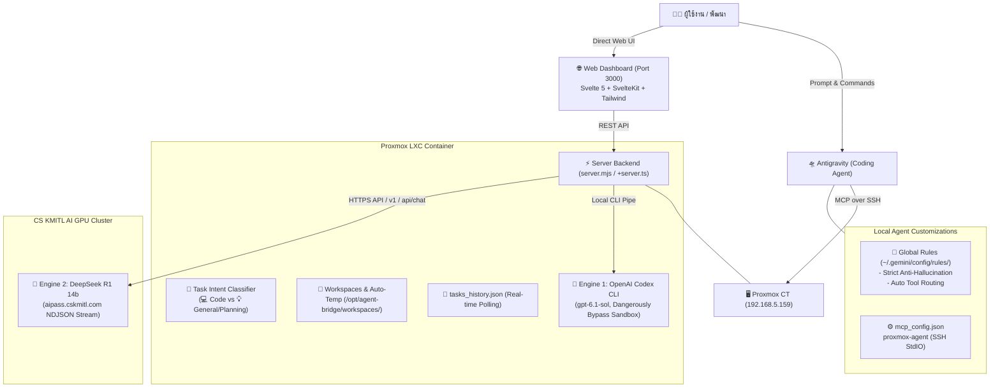

# 🌉 Proxmox Codex Bridge & Multi-Agent Platform

ระบบเชื่อมต่อและบริดจ์คำสั่งอัจฉริยะ (Multi-Agent Bridge) ที่ผสานการทำงานระหว่าง **Google Antigravity**, **OpenAI Codex (gpt-6.1-sol)** บน Proxmox LXC Container และ **DeepSeek R1 (14b GPU)** บน CS KMITL GPU Cluster พร้อม Web Dashboard ควบคุมแบบ Real-time และระบบเปรียบเทียบผลลัพธ์แบบ Dual Comparison

🌐 **Web Dashboard:** [http://192.168.5.159:3000](http://192.168.5.159:3000) (เข้าถึงผ่านเครือข่ายภายใน)

---

## 🏗️ สถาปัตยกรรมระบบ (System Architecture)



---

## 🚀 ฟีเจอร์หลัก (Core Features)

| ฟีเจอร์ | รายละเอียด | สถานะ |
| :--- | :--- | :---: |
| **11 Modular Components** | แยกโค้ดหน้าเว็บเป็น 11 คอมโพเนนต์อิสระบน Svelte 5 ด้วย Runes | ✅ ใช้งานจริง |
| **Auto Temp Workspace** | สร้าง Workspace อัตโนมัติตามชื่อคำถาม (Slugify ภาษาไทย/อังกฤษ) | ✅ ใช้งานจริง |
| **Safe Trash & Clean** | ปุ่มลบ Workspace รายตัว และปุ่มล้างโฟลเดอร์ Temp ทั้งหมด | ✅ ใช้งานจริง |
| **Task Intent Detection** | จำแนก `💻 Code Task` vs `💡 General / Planning` อัตโนมัติ ป้องกัน Timeout | ✅ ใช้งานจริง |
| **Anti-Hallucination Policy** | กฎเหล็กระดับระบบ ห้ามจำลองคำตอบ ต้องรันโมเดลจริงบนเซิร์ฟเวอร์เสมอ | ✅ ใช้งานจริง |
| **Dual Compare View** | รัน 2 โมเดลพร้อมกัน แยก Git branch และเปรียบเทียบคำตอบคู่ขนาน | ✅ ใช้งานจริง |
| **Clean State on F5** | หน้าเว็บเปิดมาด้วยสถานะพร้อมพิมพ์ ไม่ Auto-select งานเก่ากวนใจ | ✅ ใช้งานจริง |

---

## 1. 🧩 โครงสร้าง 11 Modular Components (Svelte 5 Runes)

หน้าเว็บ Web Dashboard พัฒนาด้วย **Svelte 5 บน SvelteKit** และสไตล์ด้วย **Tailwind CSS v4** โดยแยกหน้าที่ออกเป็น 11 Modular Components ใน [`dashboard/src/lib/components/`](dashboard/src/lib/components/):

```text
dashboard/src/lib/components/
├── Header.svelte             # แถบด้านบน แสดงสถานะเซิร์ฟเวอร์ โควต้า และ Token Stats
├── WorkspaceSidebar.svelte   # แถบด้านซ้าย จัดการ Workspace, Auto Temp และปุ่มลบ Trash
├── HistorySidebar.svelte     # แถบประวัติงาน ค้นหาและกรองประวัติตาม Provider
├── TaskInput.svelte          # กล่องรับ Prompt พร้อมป้าย Intent และตัวเลือก Model
├── QuickCommand.svelte       # คอนโซลรันคำสั่ง Bash ด่วนใน Workspace ปัจจุบัน
├── ResultsViewer.svelte      # ตัวจัดการแท็บ Response, Git Diff, Raw Logs และ Files
├── DualCompareView.svelte    # หน้าจอเปรียบเทียบผลลัพธ์ Codex vs DeepSeek คู่กัน
├── SingleResultView.svelte   # หน้าจอแสดงผลลัพธ์ของโมเดลเดี่ยว
├── DiffViewer.svelte         # แสดง Git diff ไฮไลต์โค้ดที่เปลี่ยนแปลง
├── ChainOfThought.svelte     # การ์ดพับ/ขยายข้อความความคิด (<think>) ของ DeepSeek
└── CloneModal.svelte         # ป๊อปอัปโคลน Git Repository เข้าสู่ Workspace
```

### การจัดการ State ด้วย Svelte 5 Runes:
* `$state(...)`: จัดการ Reactive State หลัก เช่น `history`, `activeWs`, `prompt`, `singleResult`, `dualCodex`
* `$derived(...)`: คำนวณค่าอัตโนมัติเมื่อ State เปลี่ยน เช่น `extractThoughtAndBody(result.logs)`
* `$props()` / `$bindable()`: ถ่ายทอดข้อมูลแบบ Two-way binding ระหว่างหน้าหลักและ Input Form
* **SSR Hydration Protection:** ดึงข้อมูลเริ่มต้นจาก `PageData` ส่งเข้า `$state` โดยตรง ป้องกันปัญหาหน้าเว็บกระพริบหรือข้อมูลประวัติว่างเปล่าขณะโหลดครั้งแรก

---

## 2. 🗂️ ระบบ Auto Temp Workspace และการจัดการพื้นที่

ระบบช่วยให้ผู้ใช้สั่งงานได้ทันทีโดยไม่ต้องสร้างโฟลเดอร์ล่วงหน้า:

### 2.1 Auto Temp Workspace:
* เมื่อเลือก workspace เป็น `Auto Temp` แล้วพิมพ์คำสั่ง ระบบจะนำข้อความ Prompt มาสร้างชื่อโฟลเดอร์อัตโนมัติ:
  ```text
  temp-<slug-ภาษาไทยหรืออังกฤษ>-<รหัสสุ่ม 4 ตัว>
  ตัวอย่าง: temp-สรุปข้อดีรถไฟความเร็วสูง-a9b1
  ```
* ระบบสร้างไฟล์ `README.md` และเริ่มต้น Git repository (`git init`) ให้พร้อมทำงานทันที

### 2.2 การลบ Workspace (Trash & Clean):
* **ลบรายตัว (Individual Delete):** มีปุ่มถังขยะสำหรับแต่ละ workspace (พร้อม Dialog ยืนยัน)
* **ล้าง Temp ทั้งหมด (Clean Temp):** ปุ่มลบโฟลเดอร์ที่ขึ้นต้นด้วย `temp-*` ทั้งหมดในคลิกเดียวเพื่อคืนพื้นที่ฮาร์ดดิสก์
* **ประวัติไม่สูญหาย:** การลบ workspace จะไม่ลบประวัติงานใน `tasks_history.json` ทำให้ยังสามารถเปิดดูผลลัพธ์และ Diff เก่าผ่านหน้า Dashboard ได้ตลอดเวลา

---

## 3. 🎯 Task Intent Detection (💻 Code vs 💡 General / Planning)

ปัญหาเดิมของระบบ Autonomous Coding Agent คือเมื่อได้รับคำถามทั่วไป (เช่น วางแผนท่องเที่ยว, ปรึกษาความรู้, รีวิวบทความ) ตัวโมเดลจะพยายามวิ่งค้นหาไฟล์โค้ดในโฟลเดอร์ จนเกิดอาการติดลูปหรือ Timeout

ระบบจึงติดตั้ง **Task Intent Classifier (`detectTaskType`)**:

```typescript
// dashboard/src/lib/types.ts & server.mjs
export function detectTaskType(prompt: string): 'code' | 'general'
```

### พฤติกรรมที่ปรับเปลี่ยนตามประเภทงาน:
| ประเภทงาน | ป้ายบนหน้าเว็บ | พฤติกรรมของ Codex (ChatGPT) | พฤติกรรมของ DeepSeek R1 |
| :--- | :---: | :--- | :--- |
| **💻 Code Task** | `💻 Code Task` | ตรวจสอบไฟล์ในโปรเจกต์, สร้าง Branch, เขียนโค้ด, รัน Unit Test, สร้าง Git Diff | ส่งโครงสร้างไฟล์โปรเจกต์ และสั่งให้โมเดลตอบในรูปแบบ `file:path/to/file` |
| **💡 General / Planning** | `💡 General / Planning` | ส่งคำแนะนำให้ตอบตรงประเด็นทันที ข้ามขั้นตอนค้นหาไฟล์ใน shell **(ตอบเร็วขึ้นจาก 15 นาที เหลือเพียง 7 วินาที!)** | สวมบทบาทเป็น AI Advisor ตอบภาษาไทยอย่างละเอียด ไม่ต้องพยายามแปลงเป็นไฟล์โค้ด |

---

## 4. 🛡️ กฎเหล็ก Anti-Hallucination & Multi-Agent Strict Policy

เพื่อความน่าเชื่อถือและความโปร่งใสสูงสุด ระบบได้กำหนด **Global Rules** ระดับเครื่องไว้ที่ `~/.gemini/config/rules/proxmox-codex-bridge.md` และ `~/.gemini/config/AGENTS.md`:

1. **ห้าม Roleplay หรือกุเรื่องจำลองบทสนทนาเด็ดขาด:**  
   AI ผู้ช่วยต้องไม่สมมุติตัวเองเป็น ChatGPT หรือ DeepSeek และต้องไม่แต่งบทละครการประชุม (AI Summit) ขึ้นมาเอง
2. **เรียกใช้โมเดลจริงเสมอ:**  
   เมื่อผู้ใช้พูดถึง *"ChatGPT"*, *"Codex"*, *"DeepSeek"*, หรือ *"ทั้ง 3 ตัวช่วยกันคิด"* ระบบจะต้องส่งคำขอไปยัง Proxmox Bridge (`run_dual_task`, `run_codex_task`, `run_deepseek_task`) เพื่อรันบนเครื่องจริงเท่านั้น
3. **รายงานสถานะอย่างตรงไปตรงมา:**  
   หากโมเดลตัวใดติดปัญหาคิว (เช่น DeepSeek ติด 403 GPU slot) หรือเกิด Timeout ระบบจะแจ้งสาเหตุที่แท้จริงให้ผู้ใช้ทราบทันที ไม่มีการแอบส่ง curl เองนอกรอบโดยไม่แจ้ง

---

## 5. 📊 Dual Compare View & ประวัติแบบ Real-time

* **เปรียบเทียบผลลัพธ์แบบข้างต่อข้าง (Dual Comparison):**  
  เมื่อรันในโหมด `Both (Compare)` หน้าเว็บจะแบ่งหน้าจอแสดงผลลัพธ์ของ Codex และ DeepSeek R1 พร้อมกัน สามารถสลับดูผลของแต่ละตัว หรือดู Git Diff ที่ทั้งสองฝ่ายแก้ไขแยกตาม Branch
* **การตรวจสอบความคิด (Chain-of-Thought):**  
  แท็บ Response & Reasoning มีการ์ดพับ/ขยายเพื่ออ่านกระบวนการคิดและวางแผน (`<think>...</think>`) ของโมเดล DeepSeek R1
* **Token Tracking:**  
  ติดตามจำนวน Token ที่ใช้ ทั้ง Input, Cached Tokens, และ Completion Tokens อย่างแม่นยำ

---

## 🛠️ การติดตั้งและการเชื่อมต่อ (Setup & Deployment)

### 1. การตั้งค่า MCP Server บนเครื่องผู้พัฒนา (`~/.gemini/config/mcp_config.json`):
```json
{
  "mcpServers": {
    "proxmox-agent": {
      "command": "ssh",
      "args": [
        "-T",
        "root@192.168.5.159",
        "node",
        "/opt/agent-bridge/server.mjs"
      ]
    }
  }
}
```

### 2. การจัดการ Service บน Proxmox Container:
```bash
# ตรวจสอบสถานะ Web Dashboard
systemctl status agent-web.service

# รีสตาร์ทเซอร์วิสเมื่ออัปเดตโค้ด
systemctl restart agent-web.service

# รีบิลด์ SvelteKit Dashboard
cd /opt/agent-bridge/dashboard
npm run build
```

---

## 📝 บันทึกประวัติการพัฒนา (Changelog)

* **v2.2.0 (ล่าสุด):**
  * เพิ่มระบบ **Task Intent Detection** แยกประเภทงาน `💻 Code Task` vs `💡 General / Planning` อัตโนมัติ ป้องกันปัญหา Codex ค้นหาไฟล์วนลูปจน Timeout
  * ติดตั้ง **Global Anti-Hallucination Rules** บังคับใช้ทุกห้องแชท ป้องกันการจำลองคำตอบของโมเดลอื่น
  * แก้ไขปัญหา **Auto-select บน F5** หน้าเว็บเปิดมาด้วยสถานะ Clean State เสมอ
* **v2.1.0:**
  * แยกโค้ดหน้าเว็บเป็น **11 Modular Components** บน SvelteKit 5 Runes
  * เพิ่มระบบ **Auto Temp Workspace** พร้อมการตั้งชื่อ Slugify ภาษาไทย/อังกฤษ
  * เพิ่มระบบ **Safe Trash** ลบ Workspace รายตัวและล้าง Temp แบบแยกส่วน
* **v2.0.0:**
  * เปิดตัว **Dual Comparison Engine** รัน OpenAI Codex CLI คู่กับ DeepSeek R1 KMITL GPU
  * รองรับ MCP Protocol over SSH
