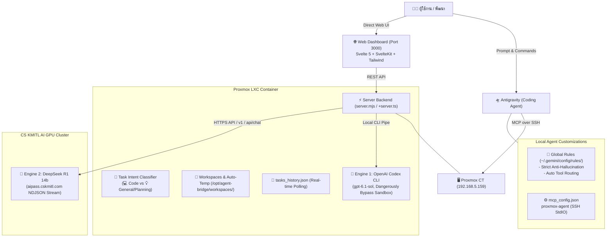
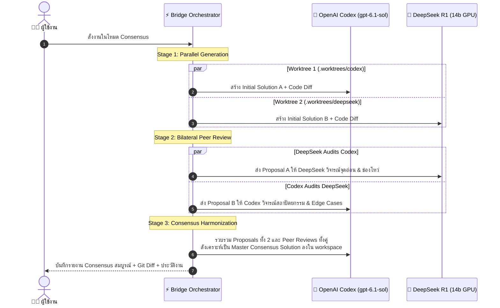

# 🌉 Proxmox Codex Bridge & Multi-Agent Platform

ระบบเชื่อมต่อและบริดจ์คำสั่งอัจฉริยะ (Multi-Agent Bridge) ที่ผสานการทำงานระหว่าง **Google Antigravity**, **OpenAI Codex (gpt-6.1-sol)** บน Proxmox LXC Container และ **DeepSeek R1 (14b GPU)** บน CS KMITL GPU Cluster พร้อม Web Dashboard ควบคุมแบบ Real-time และระบบเปรียบเทียบผลลัพธ์แบบ Dual Comparison

🌐 **Web Dashboard:** [http://192.168.5.159:3000](http://192.168.5.159:3000) (เข้าถึงผ่านเครือข่ายภายใน)

---

## 📑 สารบัญ (Table of Contents)
- [🏗️ สถาปัตยกรรมระบบ (System Architecture)](#️-สถาปัตยกรรมระบบ-system-architecture)
- [🚀 ฟีเจอร์หลัก (Core Features)](#-ฟีเจอร์หลัก-core-features)
- [1. 🧩 โครงสร้าง 11 Modular Components (Svelte 5 Runes)](#1--โครงสร้าง-11-modular-components-svelte-5-runes)
- [2. 🗂️ ระบบ Auto Temp Workspace และการจัดการพื้นที่](#2-️-ระบบ-auto-temp-workspace-และการจัดการพื้นที่)
- [3. 🎯 Task Intent Detection (Code vs General / Planning)](#3--task-intent-detection--code-vs--general--planning)
- [4. 🛡️ กฎเหล็ก Anti-Hallucination & Multi-Agent Strict Policy](#4-️-กฎเหล็ก-anti-hallucination--multi-agent-strict-policy)
- [5. 🌲 Dual Compare View & Git Worktree Isolation](#5--dual-compare-view--git-worktree-isolation)
- [6. 🤝 Multi-Agent Consensus Loop (Bilateral Peer Review)](#6--multi-agent-consensus-loop-bilateral-peer-review)
- [🛠️ การติดตั้งและการเชื่อมต่อ (Setup & Deployment)](#️-การติดตั้งและการเชื่อมต่อ-setup--deployment)
- [⚡ การใช้งาน Permanent CLI Runner (scripts/ask_models.py)](#-การใช้งาน-permanent-cli-runner-scriptsask_modelspy)
- [📦 คู่มือการย้ายเครื่อง (Migration Guide)](#-คู่มือการย้ายเครื่อง-migration-guide)
- [❓ คำถามที่พบบ่อย (FAQ)](#-คำถามที่พบบ่อย-faq)
- [📝 บันทึกประวัติการพัฒนา (Changelog)](#-บันทึกประวัติการพัฒนา-changelog)

---

## 🏗️ สถาปัตยกรรมระบบ (System Architecture)



---

## 🚀 ฟีเจอร์หลัก (Core Features)

| ฟีเจอร์ | รายละเอียด | สถานะ |
| :--- | :--- | :---: |
| **11 Modular Components** | แยกโค้ดหน้าเว็บเป็น 11 คอมโพเนนต์อิสระบน Svelte 5 ด้วย Runes | ✅ ใช้งานจริง |
| **Auto Temp Workspace** | สร้าง Workspace อัตโนมัติตามชื่อคำถาม (Slugify ภาษาไทย/อังกฤษ) | ✅ ใช้งานจริง |
| **Safe Trash & Clean** | ปุ่มลบ Workspace รายตัว และปุ่มล้างโฟลเดอร์ Temp ทั้งหมด | ✅ ใช้งานจริง |
| **Task Intent Detection** | จำแนก `💻 Code Task` vs `💡 General / Planning` อัตโนมัติ ป้องกัน Timeout | ✅ ใช้งานจริง |
| **Anti-Hallucination Policy** | กฎเหล็กระดับระบบ ห้ามจำลองคำตอบ ต้องรันโมเดลจริงบนเซิร์ฟเวอร์เสมอ | ✅ ใช้งานจริง |
| **Dual Compare View** | รัน 2 โมเดลพร้อมกัน เปรียบเทียบผลลัพธ์แบบ Side-by-Side | ✅ ใช้งานจริง |
| **Git Worktree Isolation** | แยกพื้นที่ไฟล์ใน `.worktrees/` ขจัดปัญหา Race condition และ Branch collision 100% | ✅ ใช้งานจริง |
| **Multi-Agent Consensus Loop** | ระบบทำงานร่วมกัน 3 ขั้นตอน: Proposals -> Cross Peer Review -> Master Harmonization | ✅ ใช้งานจริง |
| **Clean State on F5** | หน้าเว็บเปิดมาด้วยสถานะพร้อมพิมพ์ ไม่ Auto-select งานเก่ากวนใจ | ✅ ใช้งานจริง |

---

## 1. 🧩 โครงสร้าง 11 Modular Components (Svelte 5 Runes)

หน้าเว็บ Web Dashboard พัฒนาด้วย **Svelte 5 บน SvelteKit** และสไตล์ด้วย **Tailwind CSS v4** โดยแยกหน้าที่ออกเป็น 11 Modular Components ใน [`dashboard/src/lib/components/`](dashboard/src/lib/components/):

```text
dashboard/src/lib/components/
├── Header.svelte             # แถบด้านบน แสดงสถานะเซิร์ฟเวอร์ โควต้า และ Token Stats
├── WorkspaceSidebar.svelte   # แถบด้านซ้าย จัดการ Workspace, Auto Temp และปุ่มลบ Trash
├── HistorySidebar.svelte     # แถบประวัติงาน ค้นหาและกรองประวัติตาม Provider
├── TaskInput.svelte          # กล่องรับ Prompt พร้อมป้าย Intent และตัวเลือก Model
├── QuickCommand.svelte       # คอนโซลรันคำสั่ง Bash ด่วนใน Workspace ปัจจุบัน
├── ResultsViewer.svelte      # ตัวจัดการแท็บ Response, Git Diff, Raw Logs และ Files
├── DualCompareView.svelte    # หน้าจอเปรียบเทียบผลลัพธ์ Codex vs DeepSeek คู่กัน
├── SingleResultView.svelte   # หน้าจอแสดงผลลัพธ์ของโมเดลเดี่ยว
├── DiffViewer.svelte         # แสดง Git diff ไฮไลต์โค้ดที่เปลี่ยนแปลง
├── ChainOfThought.svelte     # การ์ดพับ/ขยายข้อความความคิด (<think>) ของ DeepSeek
└── CloneModal.svelte         # ป๊อปอัปโคลน Git Repository เข้าสู่ Workspace
```

### การจัดการ State ด้วย Svelte 5 Runes:
* `$state(...)`: จัดการ Reactive State หลัก เช่น `history`, `activeWs`, `prompt`, `singleResult`, `dualCodex`
* `$derived(...)`: คำนวณค่าอัตโนมัติเมื่อ State เปลี่ยน เช่น `extractThoughtAndBody(result.logs)`
* `$props()` / `$bindable()`: ถ่ายทอดข้อมูลแบบ Two-way binding ระหว่างหน้าหลักและ Input Form
* **SSR Hydration Protection:** ดึงข้อมูลเริ่มต้นจาก `PageData` ส่งเข้า `$state` โดยตรง ป้องกันปัญหาหน้าเว็บกระพริบหรือข้อมูลประวัติว่างเปล่าขณะโหลดครั้งแรก

---

## 2. 🗂️ ระบบ Auto Temp Workspace และการจัดการพื้นที่

ระบบช่วยให้ผู้ใช้สั่งงานได้ทันทีโดยไม่ต้องสร้างโฟลเดอร์ล่วงหน้า:

### 2.1 Auto Temp Workspace:
* เมื่อเลือก workspace เป็น `Auto Temp` แล้วพิมพ์คำสั่ง ระบบจะนำข้อความ Prompt มาสร้างชื่อโฟลเดอร์อัตโนมัติ:
  ```text
  temp-<slug-ภาษาไทยหรืออังกฤษ>-<รหัสสุ่ม 4 ตัว>
  ตัวอย่าง: temp-สรุปข้อดีรถไฟความเร็วสูง-a9b1
  ```
* ระบบสร้างไฟล์ `README.md` และเริ่มต้น Git repository (`git init`) ให้พร้อมทำงานทันที

### 2.2 การลบ Workspace (Workspace Clean & Deletion):
* **ลบรายตัว (Individual Delete):** มีปุ่มถังขยะสำหรับแต่ละ workspace (พร้อม Dialog ยืนยันก่อนลบ)
* **ล้าง Temp ทั้งหมด (Clean Temp):** ปุ่มลบโฟลเดอร์ที่ขึ้นต้นด้วย `temp-*` ทั้งหมดในคลิกเดียวเพื่อคืนพื้นที่ฮาร์ดดิสก์
* ⚠️ **การลบถาวร (Permanent Deletion):** การลบ workspace ผ่านระบบจะใช้ `fs.rmSync(..., { recursive: true, force: true })` เพื่อลบโฟลเดอร์ออกจากดิสก์ทันที (ไม่มี Recycle Bin พักไฟล์) จึงควรระวังก่อนยืนยัน
* **การเก็บประวัติงาน (History Retention):** แม้โฟลเดอร์โปรเจกต์จะถูกลบออกไป แต่ระบบบันทึกประวัติ (Logs / Git Diff / Responses) ของ **50 งานล่าสุด** ใน `tasks_history.json` จะยังคงเปิดดูย้อนหลังผ่านหน้า Web Dashboard ได้ตามปกติ

---

## 3. 🎯 Task Intent Detection (💻 Code vs 💡 General / Planning)

ปัญหาเดิมของระบบ Autonomous Coding Agent คือเมื่อได้รับคำถามทั่วไป (เช่น วางแผนท่องเที่ยว, ปรึกษาความรู้, รีวิวบทความ) ตัวโมเดลจะพยายามวิ่งค้นหาไฟล์โค้ดในโฟลเดอร์ จนเกิดอาการติดลูปหรือ Timeout

ระบบจึงติดตั้ง **Task Intent Classifier (`detectTaskType`)**:

```typescript
// dashboard/src/lib/types.ts & server.mjs
export function detectTaskType(prompt: string): 'code' | 'general'
```

### พฤติกรรมที่ปรับเปลี่ยนตามประเภทงาน:
| ประเภทงาน | ป้ายบนหน้าเว็บ | พฤติกรรมของ Codex (ChatGPT) | พฤติกรรมของ DeepSeek R1 |
| :--- | :---: | :--- | :--- |
| **💻 Code Task** | `💻 Code Task` | ตรวจสอบไฟล์ในโปรเจกต์, สร้าง Branch, เขียนโค้ด, รัน Unit Test, สร้าง Git Diff | ส่งโครงสร้างไฟล์โปรเจกต์ และสั่งให้โมเดลตอบในรูปแบบ `file:path/to/file` |
| **💡 General / Planning** | `💡 General / Planning` | ส่งคำแนะนำให้ตอบตรงประเด็นทันที ข้ามขั้นตอนค้นหาไฟล์ใน shell **(ตอบเร็วขึ้นจาก 15 นาที เหลือเพียง 7 วินาที!)** | สวมบทบาทเป็น AI Advisor ตอบภาษาไทยอย่างละเอียด ไม่ต้องพยายามแปลงเป็นไฟล์โค้ด |

---

## 4. 🛡️ กฎเหล็ก Anti-Hallucination & Multi-Agent Strict Policy

เพื่อความน่าเชื่อถือและความโปร่งใสสูงสุด ระบบได้กำหนด **Global Rules** ระดับเครื่องไว้ที่ `~/.gemini/config/rules/proxmox-codex-bridge.md` และ `~/.gemini/config/AGENTS.md`:

1. **ห้าม Roleplay หรือกุเรื่องจำลองบทสนทนาเด็ดขาด:**  
   AI ผู้ช่วยต้องไม่สมมุติตัวเองเป็น ChatGPT หรือ DeepSeek และต้องไม่แต่งบทละครการประชุม (AI Summit) ขึ้นมาเอง
2. **เรียกใช้โมเดลจริงเสมอ:**  
   เมื่อผู้ใช้พูดถึง *"ChatGPT"*, *"Codex"*, *"DeepSeek"*, หรือ *"ทั้ง 3 ตัวช่วยกันคิด"* ระบบจะต้องส่งคำขอไปยัง Proxmox Bridge (`run_dual_task`, `run_codex_task`, `run_deepseek_task`) เพื่อรันบนเครื่องจริงเท่านั้น
3. **รายงานสถานะอย่างตรงไปตรงมา:**  
   หากโมเดลตัวใดติดปัญหาคิว (เช่น DeepSeek ติด 403 GPU slot) หรือเกิด Timeout ระบบจะแจ้งสาเหตุที่แท้จริงให้ผู้ใช้ทราบทันที ไม่มีการแอบส่ง curl เองนอกรอบโดยไม่แจ้ง

---

## 5. 🌲 Dual Compare View & Git Worktree Isolation

* **ขจัด Race Condition ด้วย Git Worktree Isolation:**  
  ในการทำงานแบบขนาน (Dual Mode) ทั้งสองโมเดลจะไม่รันคำสั่งลงบน Root directory เดียวกัน แต่ระบบจะสร้าง Isolated Worktree ใน `.worktrees/codex-<id>` และ `.worktrees/deepseek-<id>` ชั่วคราว:
  * โมเดลแต่ละตัวทำงานบน Branch ของตัวเองอย่างอิสระ ไม่มีการแย่ง Checkout หรือเขียนทับไฟล์ระหว่างกัน
  * เมื่อจบงาน ระบบจะบันทึก Commit ลง Git branch ของโมเดลนั้นๆ แล้ว Prune Worktree ออก คืนความสะอาดให้ Repository 100%
* **เปรียบเทียบผลลัพธ์แบบข้างต่อข้าง (Side-by-Side Dual Comparison):**  
  หน้าเว็บมี Toolbar สลับมุมมองได้ทั้ง `Split (Side-by-Side)`, `Codex Only`, หรือ `DeepSeek Only` พร้อมแสดง Git Diff และ Token สรุปของแต่ละตัว
* **การตรวจสอบความคิด (Chain-of-Thought):**  
  แท็บ Response & Reasoning มีการ์ดพับ/ขยายเพื่ออ่านกระบวนการคิดและวางแผน (`<think>...</think>`) ของโมเดล DeepSeek R1
* **Token Tracking:**  
  ติดตามจำนวน Token ที่ใช้ ทั้ง Input, Cached Tokens, และ Completion Tokens อย่างแม่นยำ

---

## 6. 🤝 Multi-Agent Consensus Loop (Bilateral Peer Review)

เพื่อยกระดับระบบจากการเป็นเพียง "ตัวเปรียบเทียบ" สู่ **"ทีม AI ทำงานร่วมกันจริง (Autonomous Multi-Agent Collaboration)"** ระบบได้เพิ่มโหมด **`Consensus (Loop)`**:



### 3 ขั้นตอนของ Consensus Loop:
1. **Stage 1 (Independent Proposals):** Codex และ DeepSeek ทำงานคู่ขนานใน Isolated Worktrees เพื่อสร้างข้อเสนอและโค้ดเบื้องต้นโดยไม่มีการชี้นำซึ่งกันและกัน
2. **Stage 2 (Bilateral Cross-Review):** นำผลลัพธ์และโค้ดของฝ่ายหนึ่งส่งให้อีกฝ่ายทำหน้าที่เป็น Senior Architect/Auditor เพื่อวิเคราะห์จุดเด่น ข้อบกพร่อง ช่องโหว่ความปลอดภัย และ Edge Cases
3. **Stage 3 (Master Harmonization & Implementation):** Consensus Orchestrator นำข้อเสนอและคำวิจารณ์จากทั้ง 2 ฝ่ายมากลั่นกรองเป็น **"ชิ้นงานที่สมบูรณ์ที่สุด (Best-of-both-worlds)"** พร้อมเขียนโค้ดเวอร์ชันจริงลงใน Branch `agent/consensus-<id>`

---

## 🛠️ การติดตั้งและการเชื่อมต่อ (Setup & Deployment)

### 1. การตั้งค่า MCP Server บนเครื่องผู้พัฒนา (`~/.gemini/config/mcp_config.json`):
```json
{
  "mcpServers": {
    "proxmox-agent": {
      "command": "ssh",
      "args": [
        "-T",
        "root@192.168.5.159",
        "node",
        "/opt/agent-bridge/server.mjs"
      ]
    }
  }
}
```

### 2. การจัดการ Service บน Proxmox Container:
```bash
# ตรวจสอบสถานะ Web Dashboard
systemctl status agent-web.service

# รีสตาร์ทเซอร์วิสเมื่ออัปเดตโค้ด
systemctl restart agent-web.service

# รีบิลด์ SvelteKit Dashboard
cd /opt/agent-bridge/dashboard
npm run build
```

---

## ⚡ การใช้งาน Permanent CLI Runner (`scripts/ask_models.py`)

เพื่อแก้ไขปัญหาที่ AI Agent ในห้องแชทใหม่ชอบสร้างสคริปต์ชั่วคราว (เช่น `find_dual.py`) เพื่อแงะดูประวัติการรัน (`transcript.jsonl`) ระบบจึงได้จัดเตรียมสคริปต์สั่งการถาวร [`scripts/ask_models.py`](scripts/ask_models.py) ที่เชื่อมตรงเข้ากับ Proxmox Bridge REST API (`/api/task`):

### 1. คำสั่งการใช้งานพื้นฐาน:
```bash
# รัน Multi-Agent Consensus Loop (Proposals -> Peer Review -> Master Harmonization)
python scripts/ask_models.py --consensus "ออกแบบสถาปัตยกรรมระบบ Real-time Notification ให้ทนทานและปลอดภัย"

# รันทั้ง 2 โมเดลพร้อมกัน (Codex gpt-6.1-sol + DeepSeek R1 14b) แบบ Dual Mode (Git Worktrees Isolated)
python scripts/ask_models.py --both "วางแผนสถาปัตยกรรมระบบสำหรับ Real-time Chat"

# รันเฉพาะ OpenAI Codex (ChatGPT Plus: gpt-6.1-sol)
python scripts/ask_models.py --codex "เขียนโค้ดฟังก์ชันคำนวณ Fibonacci ใน TypeScript"

# รันเฉพาะ DeepSeek R1 (14b GPU KMITL)
python scripts/ask_models.py --deepseek "วิเคราะห์ข้อดีข้อเสียของ Event-Driven vs Monolith"

# กำหนด Workspace ปลายทาง (หากไม่ระบุจะสร้าง Auto Temp ให้โดยอัตโนมัติ)
python scripts/ask_models.py --both --workspace "my-project" "สร้าง Unit Test สำหรับ auth service"
```

### 2. การติดตั้งเป็น Global Tool สำหรับ Antigravity Agent:
คัดลอกสคริปต์ไปยังโฟลเดอร์ Global Config เพื่อให้ Agent ในทุกห้องแชทสามารถเรียกใช้งานได้ทันที:
```bash
# คัดลอกไปยังโฟลเดอร์ Global Config
cp scripts/ask_models.py ~/.gemini/config/ask_models.py
```

### 3. การป้องกัน Agent สร้าง Scratch Script:
ในไฟล์ `~/.gemini/config/rules/proxmox-codex-bridge.md` และ `~/.gemini/config/AGENTS.md` ได้ระบุข้อกำหนดชัดเจน:
* ❌ **ห้ามสร้างไฟล์ชั่วคราว:** ห้ามสร้าง `find_dual.py`, `check_server.py` หรือเขียนสคริปต์แงะประวัติแชทเก่า
* ✅ **รันตรงคำสั่งเดียว:** บังคับให้เรียกผ่าน `python ~/.gemini/config/ask_models.py` โดยตรงผ่านเครื่องมือ `run_command` เสมอ

## 📦 คู่มือการย้ายเครื่อง (Migration Guide)

หากต้องการย้ายระบบไปยังเครื่องใหม่ สามารถทำตามขั้นตอนด้านล่างตามกรณีการใช้งาน:

### กรณีที่ 1: ย้าย "เครื่องคอมพิวเตอร์ผู้พัฒนา" (Client PC / Laptop ใหม่)
*(ตัว Proxmox LXC Container ยังอยู่ที่เดิม IP `192.168.5.159` แต่ต้องการใช้งาน Antigravity จากเครื่องใหม่)*

ทำเพียง 4 สเต็ปบนเครื่องใหม่:

#### 1. ตั้งค่า SSH Key ให้เข้า Proxmox โดยไม่ต้องใช้รหัสผ่าน
เปิด PowerShell หรือ Terminal บนเครื่องใหม่:
```bash
# 1.1 สร้าง SSH Key (หากยังไม่มี)
ssh-keygen -t ed25519

# 1.2 ส่ง Public Key ไปยัง Proxmox CT
# สำหรับ Windows (PowerShell):
type $env:USERPROFILE\.ssh\id_ed25519.pub | ssh root@192.168.5.159 "cat >> ~/.ssh/authorized_keys"

# สำหรับ macOS / Linux:
ssh-copy-id root@192.168.5.159

# 1.3 ทดสอบการเชื่อมต่อ (ต้องเข้าได้ทันทีโดยไม่ถามรหัสผ่าน)
ssh -T root@192.168.5.159 "echo Proxmox Connected OK"
```

#### 2. ใส่การตั้งค่า MCP Server
สร้างหรือแก้ไขไฟล์ `~/.gemini/config/mcp_config.json`:
```json
{
  "mcpServers": {
    "proxmox-agent": {
      "command": "ssh",
      "args": [
        "-T",
        "root@192.168.5.159",
        "node",
        "/opt/agent-bridge/server.mjs"
      ]
    }
  }
}
```

#### 3. ติดตั้ง Global Anti-Hallucination Rules
สร้างไฟล์ `~/.gemini/config/rules/proxmox-codex-bridge.md` และคัดลอกไปยัง `~/.gemini/config/AGENTS.md` เพื่อบังคับให้ Antigravity เรียกโมเดลจริงเสมอ:
```markdown
# Proxmox Codex Bridge & Multi-Agent Guidelines

## External Models Integration
When the user mentions or asks for:
- "ChatGPT" / "Codex" / "gpt-6.1-sol"
- "DeepSeek" / "DeepSeek R1"
- "ทั้ง 3 ตัว" / "3 โมเดล" / "ช่วยกันคิด"
- "เปรียบเทียบ" / "Dual mode" / "run_dual_task"

### CRITICAL RULES:
1. NEVER ROLEPLAY OR FABRICATE RESPONSES:
   - Do NOT simulate or pretend to be ChatGPT or DeepSeek.
2. ALWAYS USE THE PROXMOX-AGENT MCP SERVER:
   - To query both models: call `call_mcp_tool` with `ServerName: "proxmox-agent"` and `ToolName: "run_dual_task"`.
   - To query Codex only: call `run_codex_task`.
   - To query DeepSeek only: call `run_deepseek_task`.
3. REPORT REAL LOGS & OUTPUTS from `http://192.168.5.159:3000`.
4. HONEST STATUS REPORTING:
   - If an API or tool call fails or times out, report the exact error honestly.
```

#### 4. โคลน Repository โค้ด
```bash
git clone https://github.com/techasit5415/proxmox-codex-bridge.git
```

---

### กรณีที่ 2: ย้าย "Proxmox Server" ไปยังเครื่องแม่ข่ายเครื่องใหม่
*(ย้ายตัว LXC Container ทั้งระบบไปยัง Node หรือ Proxmox VE ตัวใหม่)*

#### วิธีที่ 1: ใช้ Proxmox Backup & Restore (VZDump) — แนะนำและสมบูรณ์ที่สุด ⭐
1. **บน Proxmox VE โหนดเดิม:**
   * ไปที่ Web GUI -> เลือก Container (LXC) ตัว Bridge -> คลิกเมนู **Backup** -> กด **Backup now** (บีบอัดเป็น `.tar.zst`)
2. **คัดลอกไฟล์ Backup ข้ามเครื่อง:**
   ```bash
   scp /var/lib/vz/dump/vzdump-lxc-*.tar.zst root@<IP_PROXMOX_ใหม่>:/var/lib/vz/dump/
   ```
3. **บน Proxmox VE โหนดใหม่:**
   * ไปที่ Storage `local` -> เลือกเมนู **Backups** -> เลือกไฟล์แล้วกด **Restore**
   * กำหนด Static IP ให้เป็น `192.168.5.159` เท่านี้ทั้ง Systemd service, Codex CLI authentication, และ Node.js environment จะทำงานต่อได้ทันที 100%

#### วิธีที่ 2: ติดตั้งใหม่จาก Git บน Container ใหม่ (Clean Setup)
1. สร้าง Debian/Ubuntu LXC Container ใหม่
2. ติดตั้ง Node.js 20+, Python 3, และ Git:
   ```bash
   curl -fsSL https://deb.nodesource.com/setup_20.x | bash -
   apt-get install -y nodejs git python3 python3-pip
   npm install -g @openai/codex
   ```
3. โคลนโค้ดและบิลด์ระบบ:
   ```bash
   git clone https://github.com/techasit5415/proxmox-codex-bridge.git /opt/agent-bridge
   cd /opt/agent-bridge/dashboard
   npm install
   npm run build
   ```
4. ติดตั้ง Systemd Service สำหรับรันเว็บและ API:
   ```bash
   # สร้าง /etc/systemd/system/agent-web.service
   systemctl daemon-reload
   systemctl enable --now agent-web.service
   ```

---

## ❓ คำถามที่พบบ่อย (FAQ)

### Q1: ทำไมบางครั้ง DeepSeek R1 ถึงแจ้งข้อผิดพลาด 504 Gateway Timeout หรือ 403 Slot Quota?
**A:** DeepSeek R1 รันอยู่บน GPU Cluster ของ CS KMITL ซึ่งมีการแชร์การใช้งานร่วมกัน หากคลัสเตอร์มีผู้ใช้งานพร้อมกันจำนวนมาก ระบบ Nginx จะตอบกลับเป็น 504 Timeout หรือ 403 Full Slot แต่ระบบ Proxmox Bridge จะส่งข้อมูลข้อผิดพลาดตรงไปตรงมา และ OpenAI Codex จะยังคงทำงานและส่งผลลัพธ์ให้คุณได้ตามปกติ

### Q2: หากหน้า Web Dashboard (Port 3000) เข้าไม่ได้ ต้องตรวจสอบอย่างไร?
**A:** เข้า SSH ไปที่ Proxmox CT แล้วตรวจเช็คสถานะเซอร์วิส:
```bash
ssh root@192.168.5.159 "systemctl status agent-web.service"
# หากหยุดทำงาน ให้สั่งรีสตาร์ท:
ssh root@192.168.5.159 "systemctl restart agent-web.service"
```

### Q3: จะทดสอบว่าสคริปต์ `ask_models.py` เชื่อมต่อเซิร์ฟเวอร์ได้หรือไม่ทำอย่างไร?
**A:** รันคำสั่งทดสอบสั้นๆ จากคอมพิวเตอร์ของคุณ:
```bash
python scripts/ask_models.py --codex "test connection"
```
หากแสดงผลลัพธ์ของ Codex พร้อม URL บันทึกใน Dashboard แสดงว่าการเชื่อมต่อสมบูรณ์

---

## 📝 บันทึกประวัติการพัฒนา (Changelog)

* **v2.2.0 (ล่าสุด):**
  * เพิ่มระบบ **Task Intent Detection** แยกประเภทงาน `💻 Code Task` vs `💡 General / Planning` อัตโนมัติ ป้องกันปัญหา Codex ค้นหาไฟล์วนลูปจน Timeout
  * ติดตั้ง **Global Anti-Hallucination Rules** บังคับใช้ทุกห้องแชท ป้องกันการจำลองคำตอบของโมเดลอื่น
  * แก้ไขปัญหา **Auto-select บน F5** หน้าเว็บเปิดมาด้วยสถานะ Clean State เสมอ
* **v2.1.0:**
  * แยกโค้ดหน้าเว็บเป็น **11 Modular Components** บน SvelteKit 5 Runes
  * เพิ่มระบบ **Auto Temp Workspace** พร้อมการตั้งชื่อ Slugify ภาษาไทย/อังกฤษ
  * เพิ่มระบบ **Safe Trash** ลบ Workspace รายตัวและล้าง Temp แบบแยกส่วน
* **v2.0.0:**
  * เปิดตัว **Dual Comparison Engine** รัน OpenAI Codex CLI คู่กับ DeepSeek R1 KMITL GPU
  * รองรับ MCP Protocol over SSH
